# Shared Tooling

Common engineering rules, development tools and CI building blocks for
`dragginzgame` repositories. Shared Tooling has no Cargo workspace or canister
runtime dependency. Consumers retain their product architecture, compiler
policy, deployment identity and validation gates.

## Start here

| Need | Guide |
| --- | --- |
| Adopt or update Shared Tooling | [Reviewed snapshots and upgrade previews](docs/consuming-snapshots.md) |
| Prepare the compiler and tools | [Local setup](docs/local-setup.md) and [supported hosts](docs/supported-hosts.md) |
| Configure a consumer's commands | [Make interface](docs/make-interface.md) |
| Understand the common rules | [Engineering baseline](DRAGGINZGAME.md), then the consumer's `AGENTS.md` |
| Release or recover a release | [Release commands and recovery](docs/releases.md) |
| Inspect the repository fleet | [Fleet reports and CI inspection](docs/fleet-tools.md) |

## Toko stack

Each node is an individual crate or npm package, including dependencies within
the same workspace. Arrows point from consumer to dependency. For example,
`ic-memory` and `ic-storage` are separate nodes, not one `ic-persistence` node.
This is a condensed view of first-party declarations, including optional
dependencies, rather than the contents of a particular Wasm build. Dashed
arrows identify native tooling; redundant solid arrows are omitted. The
[detailed inventory](docs/stack.md) retains repository ownership, every direct
manifest declaration and build/test dependencies.

```mermaid
flowchart TD
    p_canic_7ccargo_3acanic["canic"]
    p_canic_7ccargo_3acanic_2dblob_2dservice["canic-blob-service"]
    p_canic_7ccargo_3acanic_2dcontracts["canic-contracts"]
    p_canic_7ccargo_3acanic_2dcontrol_2dplane["canic-control-plane"]
    p_canic_7ccargo_3acanic_2dcore["canic-core"]
    p_canic_7ccargo_3acanic_2dicydb["canic-icydb"]
    p_canic_7ccargo_3acanic_2dmacros["canic-macros"]
    p_ic_2dauth_7ccargo_3aic_2dauth["ic-auth"]
    p_ic_2dauth_7ccargo_3aic_2dauth_2dprotocol_2dtypes["ic-auth-protocol-types"]
    p_ic_2dblob_2dstorage_7ccargo_3aic_2dblob_2dstorage["ic-blob-storage"]
    p_ic_2dblob_2dstorage_7ccargo_3aic_2dblob_2dstorage_2dcontracts["ic-blob-storage-contracts"]
    p_ic_2dobservability_7ccargo_3aic_2dlogging["ic-logging"]
    p_ic_2dobservability_7ccargo_3aic_2dmetrics["ic-metrics"]
    p_ic_2dpersistence_7ccargo_3aic_2dmemory["ic-memory"]
    p_ic_2dpersistence_7ccargo_3aic_2dstorage["ic-storage"]
    p_ic_2dplatform_7ccargo_3aic_2dcall["ic-call"]
    p_ic_2dplatform_7ccargo_3aic_2dplatform["ic-platform"]
    p_ic_2dplatform_7ccargo_3aic_2dplatform_2dmacros["ic-platform-macros"]
    p_ic_2dplatform_7cnpm_3a_40tokostudios_2fic_2dplatform["@tokostudios/ic-platform"]
    p_ic_2dtimers_7ccargo_3aic_2dtimers["ic-timers"]
    p_ic_2dtooling_7ccargo_3aic_2dhost_2dartifacts["ic-host-artifacts"]
    p_ic_2dtooling_7ccargo_3aic_2dhost_2dfs["ic-host-fs"]
    p_ic_2dtooling_7ccargo_3aic_2dhost_2dprocess["ic-host-process"]
    p_ic_2dtooling_7ccargo_3aic_2dtestkit["ic-testkit"]
    p_ic_2dwire_7ccargo_3aic_2dwire["ic-wire"]
    p_ic_2dwire_7ccargo_3aic_2dwire_2dderive["ic-wire-derive"]
    p_icydb_7ccargo_3aicydb["icydb"]
    p_icydb_7ccargo_3aicydb_2dcore["icydb-core"]
    p_icydb_7ccargo_3aicydb_2ddiagnostic_2dcode["icydb-diagnostic-code"]
    p_icydb_7ccargo_3aicydb_2dmodel["icydb-model"]
    p_icydb_7ccargo_3aicydb_2dmodel_2dmacros["icydb-model-macros"]
    p_icydb_7ccargo_3aicydb_2dschema["icydb-schema"]
    p_toko_2dminer_7ccargo_3acanister_5ftoko_5fminer_5fblob["canister_toko_miner_blob"]
    p_toko_2dminer_7ccargo_3acanister_5ftoko_5fminer_5fgame_5fhub["canister_toko_miner_game_hub"]
    p_toko_2dminer_7ccargo_3acanister_5ftoko_5fminer_5fgame_5fshard["canister_toko_miner_game_shard"]
    p_toko_2dminer_7ccargo_3acanister_5ftoko_5fminer_5ftranslation["canister_toko_miner_translation"]
    p_toko_2dminer_7ccargo_3acanister_5ftoko_5fminer_5fuser_5fhub["canister_toko_miner_user_hub"]
    p_toko_2dminer_7ccargo_3acanister_5ftoko_5fminer_5fuser_5fshard["canister_toko_miner_user_shard"]
    p_toko_2dminer_7ccargo_3atoko_2dminer_2dcontracts["toko-miner-contracts"]
    p_toko_2dminer_7cnpm_3a_40toko_2dminer_2ffrontend["@toko-miner/frontend"]
    p_toko_7ccargo_3acanister_5fdiscovery_5fhub["canister_discovery_hub"]
    p_toko_7ccargo_3acanister_5fdiscovery_5fshard["canister_discovery_shard"]
    p_toko_7ccargo_3acanister_5fhttp_5fhub["canister_http_hub"]
    p_toko_7ccargo_3acanister_5fhttp_5fworker["canister_http_worker"]
    p_toko_7ccargo_3acanister_5fmarket["canister_market"]
    p_toko_7ccargo_3acanister_5fnotification["canister_notification"]
    p_toko_7ccargo_3acanister_5foracle_5fpokemon["canister_oracle_pokemon"]
    p_toko_7ccargo_3acanister_5foracle_5fregistry["canister_oracle_registry"]
    p_toko_7ccargo_3acanister_5fproject_5fgenerator["canister_project_generator"]
    p_toko_7ccargo_3acanister_5fproject_5fhub["canister_project_hub"]
    p_toko_7ccargo_3acanister_5fproject_5finstance["canister_project_instance"]
    p_toko_7ccargo_3acanister_5fproject_5fledger["canister_project_ledger"]
    p_toko_7ccargo_3acanister_5fproject_5fregistry["canister_project_registry"]
    p_toko_7ccargo_3acanister_5fproject_5fuser["canister_project_user"]
    p_toko_7ccargo_3acanister_5fuser_5fhub["canister_user_hub"]
    p_toko_7ccargo_3acanister_5fuser_5fshard["canister_user_shard"]
    p_toko_7ccargo_3adesign["design"]
    p_toko_7ccargo_3adesign_5fmacros["design_macros"]
    p_toko_7ccargo_3aoracle["oracle"]
    p_toko_7ccargo_3aschemagen["schemagen"]
    p_toko_7ccargo_3atoko["toko"]
    p_toko_7cnpm_3afrontend["frontend"]
    p_canic_7ccargo_3acanic --> p_canic_7ccargo_3acanic_2dcontrol_2dplane
    p_canic_7ccargo_3acanic --> p_canic_7ccargo_3acanic_2dmacros
    p_canic_7ccargo_3acanic -.-> p_ic_2dtooling_7ccargo_3aic_2dhost_2dartifacts
    p_canic_7ccargo_3acanic -.-> p_ic_2dtooling_7ccargo_3aic_2dtestkit
    p_canic_7ccargo_3acanic_2dblob_2dservice --> p_canic_7ccargo_3acanic
    p_canic_7ccargo_3acanic_2dblob_2dservice --> p_ic_2dblob_2dstorage_7ccargo_3aic_2dblob_2dstorage
    p_canic_7ccargo_3acanic_2dcontracts --> p_ic_2dauth_7ccargo_3aic_2dauth_2dprotocol_2dtypes
    p_canic_7ccargo_3acanic_2dcontrol_2dplane --> p_canic_7ccargo_3acanic_2dcore
    p_canic_7ccargo_3acanic_2dcore --> p_canic_7ccargo_3acanic_2dcontracts
    p_canic_7ccargo_3acanic_2dcore --> p_ic_2dauth_7ccargo_3aic_2dauth
    p_canic_7ccargo_3acanic_2dcore --> p_ic_2dobservability_7ccargo_3aic_2dlogging
    p_canic_7ccargo_3acanic_2dcore --> p_ic_2dpersistence_7ccargo_3aic_2dstorage
    p_canic_7ccargo_3acanic_2dcore --> p_ic_2dplatform_7ccargo_3aic_2dcall
    p_canic_7ccargo_3acanic_2dcore --> p_ic_2dtimers_7ccargo_3aic_2dtimers
    p_canic_7ccargo_3acanic_2dicydb --> p_canic_7ccargo_3acanic_2dmacros
    p_canic_7ccargo_3acanic_2dicydb --> p_ic_2dtimers_7ccargo_3aic_2dtimers
    p_ic_2dauth_7ccargo_3aic_2dauth --> p_ic_2dauth_7ccargo_3aic_2dauth_2dprotocol_2dtypes
    p_ic_2dauth_7ccargo_3aic_2dauth_2dprotocol_2dtypes --> p_ic_2dplatform_7ccargo_3aic_2dplatform
    p_ic_2dblob_2dstorage_7ccargo_3aic_2dblob_2dstorage --> p_ic_2dblob_2dstorage_7ccargo_3aic_2dblob_2dstorage_2dcontracts
    p_ic_2dblob_2dstorage_7ccargo_3aic_2dblob_2dstorage --> p_ic_2dpersistence_7ccargo_3aic_2dstorage
    p_ic_2dblob_2dstorage_7ccargo_3aic_2dblob_2dstorage_2dcontracts --> p_ic_2dobservability_7ccargo_3aic_2dmetrics
    p_ic_2dblob_2dstorage_7ccargo_3aic_2dblob_2dstorage_2dcontracts --> p_ic_2dplatform_7ccargo_3aic_2dplatform
    p_ic_2dobservability_7ccargo_3aic_2dmetrics --> p_ic_2dwire_7ccargo_3aic_2dwire
    p_ic_2dpersistence_7ccargo_3aic_2dmemory --> p_ic_2dplatform_7ccargo_3aic_2dplatform
    p_ic_2dpersistence_7ccargo_3aic_2dstorage --> p_ic_2dpersistence_7ccargo_3aic_2dmemory
    p_ic_2dplatform_7ccargo_3aic_2dcall --> p_ic_2dplatform_7ccargo_3aic_2dplatform
    p_ic_2dplatform_7ccargo_3aic_2dplatform --> p_ic_2dplatform_7ccargo_3aic_2dplatform_2dmacros
    p_ic_2dplatform_7ccargo_3aic_2dplatform -.-> p_ic_2dtooling_7ccargo_3aic_2dhost_2dartifacts
    p_ic_2dplatform_7ccargo_3aic_2dplatform --> p_ic_2dwire_7ccargo_3aic_2dwire
    p_ic_2dtimers_7ccargo_3aic_2dtimers --> p_ic_2dobservability_7ccargo_3aic_2dmetrics
    p_ic_2dtimers_7ccargo_3aic_2dtimers --> p_ic_2dplatform_7ccargo_3aic_2dplatform
    p_ic_2dtooling_7ccargo_3aic_2dhost_2dfs -.-> p_ic_2dtooling_7ccargo_3aic_2dhost_2dartifacts
    p_ic_2dtooling_7ccargo_3aic_2dhost_2dprocess -.-> p_ic_2dtooling_7ccargo_3aic_2dhost_2dartifacts
    p_ic_2dtooling_7ccargo_3aic_2dhost_2dprocess -.-> p_ic_2dtooling_7ccargo_3aic_2dhost_2dfs
    p_ic_2dtooling_7ccargo_3aic_2dtestkit -.-> p_ic_2dplatform_7ccargo_3aic_2dplatform
    p_ic_2dtooling_7ccargo_3aic_2dtestkit -.-> p_ic_2dtooling_7ccargo_3aic_2dhost_2dartifacts
    p_ic_2dtooling_7ccargo_3aic_2dtestkit -.-> p_ic_2dtooling_7ccargo_3aic_2dhost_2dfs
    p_ic_2dtooling_7ccargo_3aic_2dtestkit -.-> p_ic_2dtooling_7ccargo_3aic_2dhost_2dprocess
    p_ic_2dtooling_7ccargo_3aic_2dtestkit -.-> p_ic_2dwire_7ccargo_3aic_2dwire
    p_ic_2dwire_7ccargo_3aic_2dwire --> p_ic_2dwire_7ccargo_3aic_2dwire_2dderive
    p_icydb_7ccargo_3aicydb --> p_icydb_7ccargo_3aicydb_2dcore
    p_icydb_7ccargo_3aicydb --> p_icydb_7ccargo_3aicydb_2dmodel
    p_icydb_7ccargo_3aicydb_2dcore --> p_ic_2dobservability_7ccargo_3aic_2dmetrics
    p_icydb_7ccargo_3aicydb_2dcore --> p_ic_2dpersistence_7ccargo_3aic_2dstorage
    p_icydb_7ccargo_3aicydb_2dcore --> p_icydb_7ccargo_3aicydb_2ddiagnostic_2dcode
    p_icydb_7ccargo_3aicydb_2dcore --> p_icydb_7ccargo_3aicydb_2dschema
    p_icydb_7ccargo_3aicydb_2dmodel --> p_icydb_7ccargo_3aicydb_2dmodel_2dmacros
    p_icydb_7ccargo_3aicydb_2dmodel_2dmacros --> p_icydb_7ccargo_3aicydb_2dschema
    p_icydb_7ccargo_3aicydb_2dschema --> p_ic_2dplatform_7ccargo_3aic_2dplatform
    p_toko_2dminer_7ccargo_3acanister_5ftoko_5fminer_5fblob --> p_canic_7ccargo_3acanic_2dblob_2dservice
    p_toko_2dminer_7ccargo_3acanister_5ftoko_5fminer_5fgame_5fhub --> p_canic_7ccargo_3acanic
    p_toko_2dminer_7ccargo_3acanister_5ftoko_5fminer_5fgame_5fhub --> p_icydb_7ccargo_3aicydb
    p_toko_2dminer_7ccargo_3acanister_5ftoko_5fminer_5fgame_5fhub --> p_toko_2dminer_7ccargo_3atoko_2dminer_2dcontracts
    p_toko_2dminer_7ccargo_3acanister_5ftoko_5fminer_5fgame_5fshard --> p_canic_7ccargo_3acanic
    p_toko_2dminer_7ccargo_3acanister_5ftoko_5fminer_5fgame_5fshard --> p_canic_7ccargo_3acanic_2dicydb
    p_toko_2dminer_7ccargo_3acanister_5ftoko_5fminer_5fgame_5fshard --> p_icydb_7ccargo_3aicydb
    p_toko_2dminer_7ccargo_3acanister_5ftoko_5fminer_5fgame_5fshard --> p_toko_2dminer_7ccargo_3atoko_2dminer_2dcontracts
    p_toko_2dminer_7ccargo_3acanister_5ftoko_5fminer_5ftranslation --> p_canic_7ccargo_3acanic
    p_toko_2dminer_7ccargo_3acanister_5ftoko_5fminer_5ftranslation --> p_canic_7ccargo_3acanic_2dicydb
    p_toko_2dminer_7ccargo_3acanister_5ftoko_5fminer_5ftranslation --> p_icydb_7ccargo_3aicydb
    p_toko_2dminer_7ccargo_3acanister_5ftoko_5fminer_5ftranslation --> p_toko_2dminer_7ccargo_3atoko_2dminer_2dcontracts
    p_toko_2dminer_7ccargo_3acanister_5ftoko_5fminer_5fuser_5fhub --> p_canic_7ccargo_3acanic
    p_toko_2dminer_7ccargo_3acanister_5ftoko_5fminer_5fuser_5fhub --> p_canic_7ccargo_3acanic_2dicydb
    p_toko_2dminer_7ccargo_3acanister_5ftoko_5fminer_5fuser_5fhub --> p_icydb_7ccargo_3aicydb
    p_toko_2dminer_7ccargo_3acanister_5ftoko_5fminer_5fuser_5fhub --> p_toko_2dminer_7ccargo_3atoko_2dminer_2dcontracts
    p_toko_2dminer_7ccargo_3acanister_5ftoko_5fminer_5fuser_5fshard --> p_canic_7ccargo_3acanic
    p_toko_2dminer_7ccargo_3acanister_5ftoko_5fminer_5fuser_5fshard --> p_canic_7ccargo_3acanic_2dicydb
    p_toko_2dminer_7ccargo_3acanister_5ftoko_5fminer_5fuser_5fshard --> p_icydb_7ccargo_3aicydb
    p_toko_2dminer_7ccargo_3acanister_5ftoko_5fminer_5fuser_5fshard --> p_toko_2dminer_7ccargo_3atoko_2dminer_2dcontracts
    p_toko_2dminer_7ccargo_3atoko_2dminer_2dcontracts --> p_icydb_7ccargo_3aicydb_2dmodel
    p_toko_2dminer_7cnpm_3a_40toko_2dminer_2ffrontend --> p_ic_2dplatform_7cnpm_3a_40tokostudios_2fic_2dplatform
    p_toko_7ccargo_3acanister_5fdiscovery_5fhub --> p_canic_7ccargo_3acanic
    p_toko_7ccargo_3acanister_5fdiscovery_5fhub --> p_toko_7ccargo_3atoko
    p_toko_7ccargo_3acanister_5fdiscovery_5fshard --> p_canic_7ccargo_3acanic
    p_toko_7ccargo_3acanister_5fdiscovery_5fshard --> p_toko_7ccargo_3atoko
    p_toko_7ccargo_3acanister_5fhttp_5fhub --> p_canic_7ccargo_3acanic
    p_toko_7ccargo_3acanister_5fhttp_5fhub --> p_toko_7ccargo_3atoko
    p_toko_7ccargo_3acanister_5fhttp_5fworker --> p_canic_7ccargo_3acanic
    p_toko_7ccargo_3acanister_5fhttp_5fworker --> p_toko_7ccargo_3atoko
    p_toko_7ccargo_3acanister_5fmarket --> p_canic_7ccargo_3acanic
    p_toko_7ccargo_3acanister_5fmarket --> p_toko_7ccargo_3atoko
    p_toko_7ccargo_3acanister_5fnotification --> p_canic_7ccargo_3acanic
    p_toko_7ccargo_3acanister_5fnotification --> p_toko_7ccargo_3atoko
    p_toko_7ccargo_3acanister_5foracle_5fpokemon --> p_canic_7ccargo_3acanic
    p_toko_7ccargo_3acanister_5foracle_5fpokemon --> p_toko_7ccargo_3aoracle
    p_toko_7ccargo_3acanister_5foracle_5fpokemon --> p_toko_7ccargo_3atoko
    p_toko_7ccargo_3acanister_5foracle_5fregistry --> p_canic_7ccargo_3acanic
    p_toko_7ccargo_3acanister_5foracle_5fregistry --> p_toko_7ccargo_3atoko
    p_toko_7ccargo_3acanister_5fproject_5fgenerator --> p_canic_7ccargo_3acanic
    p_toko_7ccargo_3acanister_5fproject_5fgenerator --> p_toko_7ccargo_3atoko
    p_toko_7ccargo_3acanister_5fproject_5fhub --> p_canic_7ccargo_3acanic
    p_toko_7ccargo_3acanister_5fproject_5fhub --> p_toko_7ccargo_3atoko
    p_toko_7ccargo_3acanister_5fproject_5finstance --> p_canic_7ccargo_3acanic
    p_toko_7ccargo_3acanister_5fproject_5finstance --> p_toko_7ccargo_3atoko
    p_toko_7ccargo_3acanister_5fproject_5fledger --> p_canic_7ccargo_3acanic
    p_toko_7ccargo_3acanister_5fproject_5fledger --> p_toko_7ccargo_3atoko
    p_toko_7ccargo_3acanister_5fproject_5fregistry --> p_canic_7ccargo_3acanic
    p_toko_7ccargo_3acanister_5fproject_5fregistry --> p_toko_7ccargo_3atoko
    p_toko_7ccargo_3acanister_5fproject_5fuser --> p_canic_7ccargo_3acanic
    p_toko_7ccargo_3acanister_5fproject_5fuser --> p_toko_7ccargo_3atoko
    p_toko_7ccargo_3acanister_5fuser_5fhub --> p_canic_7ccargo_3acanic
    p_toko_7ccargo_3acanister_5fuser_5fhub --> p_toko_7ccargo_3atoko
    p_toko_7ccargo_3acanister_5fuser_5fshard --> p_canic_7ccargo_3acanic
    p_toko_7ccargo_3acanister_5fuser_5fshard --> p_toko_7ccargo_3atoko
    p_toko_7ccargo_3adesign --> p_icydb_7ccargo_3aicydb
    p_toko_7ccargo_3adesign --> p_toko_7ccargo_3adesign_5fmacros
    p_toko_7ccargo_3aoracle --> p_toko_7ccargo_3adesign
    p_toko_7ccargo_3aschemagen -.-> p_canic_7ccargo_3acanic_2dcontrol_2dplane
    p_toko_7ccargo_3aschemagen -.-> p_canic_7ccargo_3acanic_2dcore
    p_toko_7ccargo_3aschemagen -.-> p_canic_7ccargo_3acanic_2dmacros
    p_toko_7ccargo_3aschemagen -.-> p_icydb_7ccargo_3aicydb_2dmodel
    p_toko_7ccargo_3aschemagen -.-> p_toko_7ccargo_3adesign
    p_toko_7ccargo_3atoko --> p_toko_7ccargo_3adesign
```

<!-- stack-graph:start -->

<!-- stack-graph:end -->

The [daily local refresh](docs/stack.md#automatic-local-refresh) keeps generated
sections current once enabled, leaving changes for the next commit. It neither
fetches upstream changes nor commits them. Manual refresh/check commands remain
available in that guide.

## Repository fleet ownership

Shared Tooling owns common rules and helpers, adoption/pin drift inspection,
repository inventories, CI/issue dashboards and repeatable maintenance audits.
Central reports run here; consumers need only the helpers their workflows use,
not extra CI gates that scan sibling checkouts. Product repositories retain
behavior, acceptance evidence and issue resolution. Reporting does not grant
edit or deployment authority.

Keep reporting here while it shares this maintenance lifecycle. A hosted
application with its own data, authentication and deployment lifecycle would
need a separate owner. The [contribution inclusion test](CONTRIBUTING.md#inclusion-test)
explains what belongs in Shared Tooling.

## Capability ownership

| Capability | Canonical owner |
| --- | --- |
| Common rules, setup, formatting, release mechanics, snapshots and fleet reports | Shared Tooling: `rules/`, `scripts/`, `make/` and `.github/actions/` |
| External IC-specific dependencies and browser SDK boundary | [IC Platform](https://github.com/dragginzgame/ic-platform), through explicit features and interfaces |
| Owned application encoding and generated TypeScript codecs | [IC Wire](https://github.com/dragginzgame/ic-wire); consumers own transport and application semantics |
| Cargo/Wasm builds, host primitives, artifact encoding and PocketIC lifecycle | [IC Tooling](https://github.com/dragginzgame/ic-tooling): Build, Host and Testkit in one workspace |
| Metrics and logging | [IC Observability](https://github.com/dragginzgame/ic-observability): `ic-metrics` and `ic-logging`, required by the [shared rule](DRAGGINZGAME.md#metrics-and-logging); fleet discovery and dashboards remain here |
| Product deployment, limits, release inputs and acceptance evidence | Each consuming repository |

Shared distributes reviewed commands and source; consumers compile the standalone
Rust scanner with locked dependencies. `ci/frontend` is a private formatting
qualification fixture. Shared's release and snapshot lifecycle is independent
of the product workspaces.

## Consuming repositories

Adopt an exact reviewed revision through the [snapshot exporter](docs/consuming-snapshots.md),
including its declared companion files, and verify the recorded snapshot offline.
Use `--preview` to review an upgrade before applying it. CI and releases use the
reviewed files, rather than loading Shared Tooling from a mutable sibling
checkout, moving download URL or symlink. Interactive read-only fleet reports
may inspect siblings directly.

Consumers use `make/consumer.mk` for shared setup, checks, formatting and release
mechanics, with explicit local inputs. Browser/npm checks are [opt-in](docs/node-tools.md).
Review [migration impact](docs/consuming-snapshots.md#upgrade-impact) alongside
[release notes](CHANGELOG.md); a refreshed snapshot alone does not qualify
consumer behavior. Applicable workflows support macOS under the
[host contract](docs/supported-hosts.md).

## Current tools

| Task | Entry point and reference |
| --- | --- |
| Install or verify prepared tools | `make install-tools`, `make tools-check`; [local setup](docs/local-setup.md) |
| Inspect all existing tool checks | `make tools-report`; [diagnostics](docs/local-setup.md#tool-selection-and-diagnostics) |
| Install selected IC executables | `make install-ic-tools`; [IC tools and ownership](docs/ic-tools.md) |
| Format a Rust consumer or enable its commit hook | Consumer `make fmt`, `make fmt-check`, `make install-hooks`; [formatting contract](rules/git-hooks.md) |
| Check dependency declarations | `make check-pins`; [pinning policy](rules/dependency-pinning.md) and [helper contracts](docs/verification-helpers.md) |
| Report sibling Rust/tooling LOC | `make cloc`, `make cloc-tooling`; [fleet reports](docs/fleet-tools.md) |
| Inspect issues, PRs or CI runs | `scripts/dev/github-siblings.sh`, `scripts/dev/gh-ci.sh`; [usage and limits](docs/fleet-tools.md) |
| Run selected Make checks with retained evidence | [Validation target runner](docs/validation-runner.md) |
| Reuse checksum, source, archive and publication checks | [Verification helper contracts](docs/verification-helpers.md) |

Shared's own integration fixtures additionally require its prepared IC Build
release editor; [local setup](docs/local-setup.md#shared-toolings-integration-editor)
owns that selection. Shared does not activate Rust formatting hooks in this
non-Cargo checkout. Installer pins, platform coverage and command options live
in their guides rather than being repeated here.

## Repeatable maintenance

The [task catalog](tasks/README.md), also available through `make tasks`, covers
CI health, snapshot drift, dependency advisories, compiler/tool freshness,
README accuracy and bounded code/tooling audits. The optional
[agent schedule](tasks/local-schedule.md) runs a read-only maintenance pass every
three days and coordinates findings through owning issues. It is separate
from the deterministic stack-diagram timer.

## Shared principles

Read the [baseline](DRAGGINZGAME.md) and local overlay first. [Engineering
principles](docs/principles/README.md), focused policies in `rules/` and the
[shared audit methods](audits/README.md) support that baseline; product-specific
choices and historical reports remain with consumers. [Provenance](docs/provenance.md)
records earlier extractions rather than defining today's ownership.

## Contributing and validation

Read [CONTRIBUTING.md](CONTRIBUTING.md) and this repository's [AGENTS.md](AGENTS.md).
Prepare [Shared's pinned compiler](docs/local-setup.md#shared-toolings-own-compiler)
before installing Cargo tools. For ordinary changes, select the affected
fixtures and checks; documentation-only changes use `make check-doc-links` and
`git diff --check`. `make ci`, `make test-portable` and `make check-shell` are
aggregate gates for releases or explicit full-check requests.

`make version` reads [VERSION](VERSION); the top undated [changelog](CHANGELOG.md)
entry describes pending work and does not prove publication. Tags establish
release identity. Releases and recovery follow the [release contract](docs/releases.md).

Licensed under [MIT](LICENSE).
