# Toko stack overview

A compact view of the applications and main library crates. Rounded nodes group
each application's packages. Boxes show workspaces and their declared release
groups, labelled with local manifest versions; individual crates stay separate.
Arrows follow consumer → dependency paths through omitted internal
helpers; redundant arrows are omitted. This compact view uses unconditional
normal declarations outside native and explicitly classified qualification packages;
it is not a resolved build graph. The [full package graph and manifest
evidence](stack.md#full-package-graph) include internal, browser and native tools,
including groups not yet reachable from the applications. The
[release-group inventory](stack.md#release-groups) lists complete membership
and changelogs. These local declarations can include pending work; they do not
establish publication or compatible downstream adoption.

```mermaid
flowchart TD
    p_app_3atoko(["toko"])
    p_app_3atoko_2dminer(["toko-miner"])
    subgraph p_repo_3acanic["canic"]
        subgraph p_group_3acanic_7cframework["framework · 0.115.0"]
            p_canic_7ccargo_3acanic["canic"]
        end
    end
    subgraph p_repo_3aic_2dauth["ic-auth"]
        subgraph p_group_3aic_2dauth_7cengine["engine · 0.36.1"]
            p_ic_2dauth_7ccargo_3aic_2dauth["ic-auth"]
        end
    end
    subgraph p_repo_3aic_2dblob_2dstorage["ic-blob-storage"]
        subgraph p_group_3aic_2dblob_2dstorage_7cengine["engine · 0.78.0"]
            p_ic_2dblob_2dstorage_7ccargo_3aic_2dblob_2dstorage["ic-blob-storage"]
        end
    end
    subgraph p_repo_3aic_2dobservability["ic-observability"]
        subgraph p_group_3aic_2dobservability_7clogging["logging · 0.24.13"]
            p_ic_2dobservability_7ccargo_3aic_2dlogging["ic-logging"]
        end
        subgraph p_group_3aic_2dobservability_7cmetrics["metrics · 0.29.8"]
            p_ic_2dobservability_7ccargo_3aic_2dmetrics["ic-metrics"]
        end
    end
    subgraph p_repo_3aic_2dplatform["ic-platform"]
        subgraph p_group_3aic_2dplatform_7cplatform["platform · 0.27.1"]
            p_ic_2dplatform_7ccargo_3aic_2dplatform["ic-platform"]
        end
        subgraph p_group_3aic_2dplatform_7cruntime["runtime · 0.20.3"]
            p_ic_2dplatform_7ccargo_3aic_2dplatform_2druntime["ic-platform-runtime"]
        end
        subgraph p_group_3aic_2dplatform_7ctypes["types · 0.18.3"]
            p_ic_2dplatform_7ccargo_3aic_2dplatform_2dtypes["ic-platform-types"]
        end
    end
    subgraph p_repo_3aic_2dscheduling["ic-scheduling"]
        subgraph p_group_3aic_2dscheduling_7ctimers["timers · 0.41.5"]
            p_ic_2dscheduling_7ccargo_3aic_2dtimers["ic-timers"]
        end
    end
    subgraph p_repo_3aic_2dstorage["ic-storage"]
        subgraph p_group_3aic_2dstorage_7cmetrics_2dstorage["metrics-storage · 0.73.0"]
            p_ic_2dstorage_7ccargo_3aic_2dmetrics_2dstorage["ic-metrics-storage"]
        end
        subgraph p_group_3aic_2dstorage_7cstorage["storage · 0.71.0"]
            p_ic_2dstorage_7ccargo_3aic_2dstorage["ic-storage"]
        end
    end
    subgraph p_repo_3aic_2dwire["ic-wire"]
        subgraph p_group_3aic_2dwire_7ccore["core · 0.18.0"]
            p_ic_2dwire_7ccargo_3aic_2dwire["ic-wire"]
        end
    end
    subgraph p_repo_3aicydb["icydb"]
        subgraph p_group_3aicydb_7cdatabase["database · 0.305.0"]
            p_icydb_7ccargo_3aicydb["icydb"]
        end
    end
    p_app_3atoko --> p_canic_7ccargo_3acanic
    p_app_3atoko --> p_icydb_7ccargo_3aicydb
    p_app_3atoko_2dminer --> p_canic_7ccargo_3acanic
    p_app_3atoko_2dminer --> p_ic_2dblob_2dstorage_7ccargo_3aic_2dblob_2dstorage
    p_app_3atoko_2dminer --> p_icydb_7ccargo_3aicydb
    p_canic_7ccargo_3acanic --> p_ic_2dauth_7ccargo_3aic_2dauth
    p_canic_7ccargo_3acanic --> p_ic_2dobservability_7ccargo_3aic_2dlogging
    p_canic_7ccargo_3acanic --> p_ic_2dplatform_7ccargo_3aic_2dplatform
    p_canic_7ccargo_3acanic --> p_ic_2dscheduling_7ccargo_3aic_2dtimers
    p_canic_7ccargo_3acanic --> p_ic_2dstorage_7ccargo_3aic_2dmetrics_2dstorage
    p_ic_2dauth_7ccargo_3aic_2dauth --> p_ic_2dplatform_7ccargo_3aic_2dplatform_2dtypes
    p_ic_2dblob_2dstorage_7ccargo_3aic_2dblob_2dstorage --> p_ic_2dplatform_7ccargo_3aic_2dplatform
    p_ic_2dblob_2dstorage_7ccargo_3aic_2dblob_2dstorage --> p_ic_2dplatform_7ccargo_3aic_2dplatform_2dtypes
    p_ic_2dblob_2dstorage_7ccargo_3aic_2dblob_2dstorage --> p_ic_2dstorage_7ccargo_3aic_2dstorage
    p_ic_2dblob_2dstorage_7ccargo_3aic_2dblob_2dstorage --> p_ic_2dwire_7ccargo_3aic_2dwire
    p_ic_2dscheduling_7ccargo_3aic_2dtimers --> p_ic_2dobservability_7ccargo_3aic_2dmetrics
    p_ic_2dscheduling_7ccargo_3aic_2dtimers --> p_ic_2dplatform_7ccargo_3aic_2dplatform_2druntime
    p_ic_2dstorage_7ccargo_3aic_2dmetrics_2dstorage --> p_ic_2dobservability_7ccargo_3aic_2dmetrics
    p_ic_2dstorage_7ccargo_3aic_2dmetrics_2dstorage --> p_ic_2dstorage_7ccargo_3aic_2dstorage
    p_ic_2dstorage_7ccargo_3aic_2dmetrics_2dstorage --> p_ic_2dwire_7ccargo_3aic_2dwire
    p_icydb_7ccargo_3aicydb --> p_ic_2dplatform_7ccargo_3aic_2dplatform_2druntime
    p_icydb_7ccargo_3aicydb --> p_ic_2dplatform_7ccargo_3aic_2dplatform_2dtypes
    p_icydb_7ccargo_3aicydb --> p_ic_2dstorage_7ccargo_3aic_2dstorage
    p_icydb_7ccargo_3aicydb --> p_ic_2dwire_7ccargo_3aic_2dwire
```

<!-- stack-graph:start -->

<!-- stack-graph:end -->

The [daily local refresh](stack.md#automatic-local-refresh) keeps generated
sections current once enabled, leaving changes for the next commit. It neither
fetches upstream changes nor commits them. Manual refresh/check commands remain
available in that guide.

