# Toko stack dependency overview

The [README diagram](../README.md#toko-stack) is a compact application and library
overview. The expandable [full package graph](#full-package-graph) below retains
individual first-party crates and npm packages, including dependencies within
one workspace. Both start at the **Toko** and **Toko Miner** applications; they
are separate products, with no assumed dependency between them.

Arrows point from consumer to dependency. Repository ownership is recorded in
the inventory: `ic-memory`, `ic-storage` and `ic-metrics-stable` are independent
packages within `ic-persistence`. The direct-evidence table retains every
first-party declaration from the selected packages, including build and
development dependencies.

## README overview

The catalog's `overview` crate list selects the library entry points worth showing
on the README. Each application workspace becomes one rounded node. Other
internal crates are traversed to the next displayed dependency; an arrow can
therefore represent several real declaration steps. A crate never acquires an
unrelated sibling's dependencies. Browser packages and native tooling are shown
only in the full graph. Review this list when adding a new application capability;
new helper crates do not automatically expand the README. Custom catalogs without
an `overview` list show all selected non-native Rust crates.

Redundant arrows are omitted when the relevant graph is acyclic. In the full
graph, dashed arrows identify normal dependencies from or to catalogued native
packages; native paths do not hide library dependencies during reduction.

## Scope and interpretation

- The [catalog](stack-catalog.json) selects production/library and host-tool
  package directories. It excludes dedicated test, demo, qualification and
  benchmark packages where those share a workspace. The inventory below makes
  the exact selection reviewable; update the catalog when layouts change.
- Cargo edges come from actual member dependencies, including inherited and
  renamed packages, not unused entries in `[workspace.dependencies]`. Normal
  dependencies include optional and target-specific declarations. Host tools
  and code generators can have normal dependencies too: these arrows do **not**
  mean a crate is compiled into every canister or into Wasm.
- The selected frontend and browser `package.json` files contribute first-party
  npm dependencies. The SDK package belongs to IC Platform. External Cargo/npm
  dependencies and generated frontend declarations are outside this overview.
- Package names map declarations to the catalogued local owner. A first-party
  Git dependency absent from that owner's current checkout remains a distinct
  package marked **pinned Git**; no outgoing dependencies are inferred for it.
  Unrelated packages in the same workspace do not contribute dependencies to a
  reachable crate. This combines
  current local checkouts, which can contain pending work. It is not a resolved
  lockfile graph, publication/adoption proof, version compatibility check, feature
  closure, deployed topology or Wasm-size report. Source links navigate to the
  owner's catalogued default branch (`development` for Toko, otherwise `main`);
  they do not certify that local changes have been pushed there.
- Shared Tooling owns this central report and development/governance helpers;
  it is not a canister runtime dependency. Snapshot adoption and runtime
  interactions are not inferred from Cargo or npm declarations. Product runtime
  architecture stays with the product repositories.

## Refreshing the overview

With the catalogued checkouts as siblings and Shared Tooling's Cargo toolchain
already prepared, run from Shared Tooling:

```bash
make stack-graph
make check-stack-graph
# Alternative checkout parent:
make stack-graph STACK_PARENT=/path/to/projects
```

The command uses Perl core modules and `cargo metadata --no-deps --offline
--locked`. It keeps the caller's prepared toolchain and Cargo configuration;
it neither builds nor edits siblings. Prepare the compiler first, as required
above, so invoking Cargo does not trigger Rustup toolchain installation.
It updates only the marked blocks in the README and this document after every
catalogued workspace has been read successfully. Missing checkouts, invalid
metadata and ambiguous package owners fail rather than producing a partial graph.
`--check` is read-only. Review and commit both outputs together after meaningful
dependency or workspace changes. This is a central maintainer command, not a
consumer release gate or CI requirement for a checkout without its siblings.

## Automatic local refresh

The deterministic [service](../tasks/systemd/shared-tooling-stack-graph.service)
and [timer](../tasks/systemd/shared-tooling-stack-graph.timer) refresh the generated
sections daily at **09:15 in the host timezone**, while the user manager is
running. A missed refresh runs when the persistent timer becomes active again;
there is no requirement to keep the computer awake or enable user lingering.
This is separate from the agent maintenance timer and needs no Codex or GitHub
credentials. It reads the existing local checkouts, including pending work;
it does not fetch newer branches or registry packages.

The service uses Shared Tooling's already prepared compiler, disables Rustup
automatic installation and runs Cargo offline. It does not stage, commit, push
or edit siblings. Unchanged output is left untouched; changed generated blocks
appear as working-tree edits for the next normal commit. Handwritten content
outside those blocks is preserved. Missing/broken inputs fail with journal
diagnostics and leave the previous documentation intact; no partial graph is
published. The next scheduled attempt is the next day, without a retry loop.

Installation is explicit and host-local. Create the regular file
`~/.config/shared-tooling/stack-graph.env` with absolute checkout locations and
a prepared Cargo executable on `PATH`, for example:

```text
SHARED_TOOLING_ROOT=/home/USER/projects/shared-tooling
STACK_PROJECTS_ROOT=/home/USER/projects
PATH=/home/USER/.cargo/bin:/usr/local/bin:/usr/bin:/bin
```

Use systemd EnvironmentFile quoting for values containing spaces. Copy both unit
files into `~/.config/systemd/user/`, preserving unrelated host configuration;
verify them with `systemd-analyze --user verify` before enabling. Then:

```bash
systemctl --user daemon-reload
systemctl --user enable --now shared-tooling-stack-graph.timer
systemctl --user start shared-tooling-stack-graph.service
systemctl --user list-timers shared-tooling-stack-graph.timer
journalctl --user -u shared-tooling-stack-graph.service
```

That first service run verifies actual execution; enabling a timer alone does
not prove a successful refresh. The service serializes timer starts and stops
after five minutes. Prefer starting it through systemd for manual retries too.
Pause future runs with `systemctl --user disable --now
shared-tooling-stack-graph.timer`; stop the service separately if it is active.
After changing these templates, review and reinstall the host-owned copies.
The timer reads the selected checkout's current generator and catalog. Snapshot
adoption does not install or enable this timer for consumers.

<!-- stack-graph:start -->
## Full package graph

```mermaid
flowchart TD
    p_canic_7ccargo_3acanic["canic"]
    p_canic_7ccargo_3acanic_2dblob_2dservice["canic-blob-service"]
    p_canic_7ccargo_3acanic_2dcontracts["canic-contracts"]
    p_canic_7ccargo_3acanic_2dcontrol_2dplane["canic-control-plane"]
    p_canic_7ccargo_3acanic_2dcore["canic-core"]
    p_canic_7ccargo_3acanic_2dicydb["canic-icydb"]
    p_canic_7ccargo_3acanic_2dmacros["canic-macros"]
    p_ic_2dauth_7ccargo_3aic_2dauth["ic-auth"]
    p_ic_2dauth_7ccargo_3aic_2dauth_2dprotocol_2dtypes["ic-auth-protocol-types"]
    p_ic_2dblob_2dstorage_7ccargo_3aic_2dblob_2dstorage["ic-blob-storage"]
    p_ic_2dblob_2dstorage_7ccargo_3aic_2dblob_2dstorage_2dcontracts["ic-blob-storage-contracts"]
    p_ic_2dobservability_7ccargo_3aic_2dlogging["ic-logging"]
    p_ic_2dobservability_7ccargo_3aic_2dmetrics["ic-metrics"]
    p_ic_2dpersistence_7ccargo_3aic_2dmemory["ic-memory"]
    p_ic_2dpersistence_7ccargo_3aic_2dstorage["ic-storage"]
    p_ic_2dplatform_7ccargo_3aic_2dcall["ic-call"]
    p_ic_2dplatform_7ccargo_3aic_2dplatform["ic-platform"]
    p_ic_2dplatform_7ccargo_3aic_2dplatform_2dmacros["ic-platform-macros"]
    p_ic_2dplatform_7cnpm_3a_40tokostudios_2fic_2dplatform["@tokostudios/ic-platform"]
    p_ic_2dtimers_7ccargo_3aic_2dtimers["ic-timers"]
    p_ic_2dtooling_7ccargo_3aic_2dhost_2dartifacts["ic-host-artifacts"]
    p_ic_2dtooling_7ccargo_3aic_2dhost_2dfs["ic-host-fs"]
    p_ic_2dtooling_7ccargo_3aic_2dhost_2dprocess["ic-host-process"]
    p_ic_2dtooling_7ccargo_3aic_2dtestkit["ic-testkit"]
    p_ic_2dwire_7ccargo_3aic_2dwire["ic-wire"]
    p_ic_2dwire_7ccargo_3aic_2dwire_2dderive["ic-wire-derive"]
    p_icydb_7ccargo_3aicydb["icydb"]
    p_icydb_7ccargo_3aicydb_2dcore["icydb-core"]
    p_icydb_7ccargo_3aicydb_2ddiagnostic_2dcode["icydb-diagnostic-code"]
    p_icydb_7ccargo_3aicydb_2dmodel["icydb-model"]
    p_icydb_7ccargo_3aicydb_2dmodel_2dmacros["icydb-model-macros"]
    p_icydb_7ccargo_3aicydb_2dschema["icydb-schema"]
    p_toko_2dminer_7ccargo_3acanister_5ftoko_5fminer_5fblob["canister_toko_miner_blob"]
    p_toko_2dminer_7ccargo_3acanister_5ftoko_5fminer_5fgame_5fhub["canister_toko_miner_game_hub"]
    p_toko_2dminer_7ccargo_3acanister_5ftoko_5fminer_5fgame_5fshard["canister_toko_miner_game_shard"]
    p_toko_2dminer_7ccargo_3acanister_5ftoko_5fminer_5ftranslation["canister_toko_miner_translation"]
    p_toko_2dminer_7ccargo_3acanister_5ftoko_5fminer_5fuser_5fhub["canister_toko_miner_user_hub"]
    p_toko_2dminer_7ccargo_3acanister_5ftoko_5fminer_5fuser_5fshard["canister_toko_miner_user_shard"]
    p_toko_2dminer_7ccargo_3atoko_2dminer_2dcontracts["toko-miner-contracts"]
    p_toko_2dminer_7cnpm_3a_40toko_2dminer_2ffrontend["@toko-miner/frontend"]
    p_toko_7ccargo_3acanister_5fdiscovery_5fhub["canister_discovery_hub"]
    p_toko_7ccargo_3acanister_5fdiscovery_5fshard["canister_discovery_shard"]
    p_toko_7ccargo_3acanister_5fhttp_5fhub["canister_http_hub"]
    p_toko_7ccargo_3acanister_5fhttp_5fworker["canister_http_worker"]
    p_toko_7ccargo_3acanister_5fmarket["canister_market"]
    p_toko_7ccargo_3acanister_5fnotification["canister_notification"]
    p_toko_7ccargo_3acanister_5foracle_5fpokemon["canister_oracle_pokemon"]
    p_toko_7ccargo_3acanister_5foracle_5fregistry["canister_oracle_registry"]
    p_toko_7ccargo_3acanister_5fproject_5fgenerator["canister_project_generator"]
    p_toko_7ccargo_3acanister_5fproject_5fhub["canister_project_hub"]
    p_toko_7ccargo_3acanister_5fproject_5finstance["canister_project_instance"]
    p_toko_7ccargo_3acanister_5fproject_5fledger["canister_project_ledger"]
    p_toko_7ccargo_3acanister_5fproject_5fregistry["canister_project_registry"]
    p_toko_7ccargo_3acanister_5fproject_5fuser["canister_project_user"]
    p_toko_7ccargo_3acanister_5fuser_5fhub["canister_user_hub"]
    p_toko_7ccargo_3acanister_5fuser_5fshard["canister_user_shard"]
    p_toko_7ccargo_3adesign["design"]
    p_toko_7ccargo_3adesign_5fmacros["design_macros"]
    p_toko_7ccargo_3aoracle["oracle"]
    p_toko_7ccargo_3aschemagen["schemagen"]
    p_toko_7ccargo_3atoko["toko"]
    p_toko_7cnpm_3afrontend["frontend"]
    p_canic_7ccargo_3acanic --> p_canic_7ccargo_3acanic_2dcontrol_2dplane
    p_canic_7ccargo_3acanic --> p_canic_7ccargo_3acanic_2dmacros
    p_canic_7ccargo_3acanic -.-> p_ic_2dtooling_7ccargo_3aic_2dhost_2dartifacts
    p_canic_7ccargo_3acanic -.-> p_ic_2dtooling_7ccargo_3aic_2dtestkit
    p_canic_7ccargo_3acanic_2dblob_2dservice --> p_canic_7ccargo_3acanic
    p_canic_7ccargo_3acanic_2dblob_2dservice --> p_ic_2dblob_2dstorage_7ccargo_3aic_2dblob_2dstorage
    p_canic_7ccargo_3acanic_2dcontracts --> p_ic_2dauth_7ccargo_3aic_2dauth_2dprotocol_2dtypes
    p_canic_7ccargo_3acanic_2dcontrol_2dplane --> p_canic_7ccargo_3acanic_2dcore
    p_canic_7ccargo_3acanic_2dcore --> p_canic_7ccargo_3acanic_2dcontracts
    p_canic_7ccargo_3acanic_2dcore --> p_ic_2dauth_7ccargo_3aic_2dauth
    p_canic_7ccargo_3acanic_2dcore --> p_ic_2dobservability_7ccargo_3aic_2dlogging
    p_canic_7ccargo_3acanic_2dcore --> p_ic_2dpersistence_7ccargo_3aic_2dstorage
    p_canic_7ccargo_3acanic_2dcore --> p_ic_2dplatform_7ccargo_3aic_2dcall
    p_canic_7ccargo_3acanic_2dcore --> p_ic_2dtimers_7ccargo_3aic_2dtimers
    p_canic_7ccargo_3acanic_2dicydb --> p_canic_7ccargo_3acanic_2dmacros
    p_canic_7ccargo_3acanic_2dicydb --> p_ic_2dtimers_7ccargo_3aic_2dtimers
    p_ic_2dauth_7ccargo_3aic_2dauth --> p_ic_2dauth_7ccargo_3aic_2dauth_2dprotocol_2dtypes
    p_ic_2dauth_7ccargo_3aic_2dauth_2dprotocol_2dtypes --> p_ic_2dplatform_7ccargo_3aic_2dplatform
    p_ic_2dblob_2dstorage_7ccargo_3aic_2dblob_2dstorage --> p_ic_2dblob_2dstorage_7ccargo_3aic_2dblob_2dstorage_2dcontracts
    p_ic_2dblob_2dstorage_7ccargo_3aic_2dblob_2dstorage --> p_ic_2dpersistence_7ccargo_3aic_2dstorage
    p_ic_2dblob_2dstorage_7ccargo_3aic_2dblob_2dstorage_2dcontracts --> p_ic_2dobservability_7ccargo_3aic_2dmetrics
    p_ic_2dblob_2dstorage_7ccargo_3aic_2dblob_2dstorage_2dcontracts --> p_ic_2dplatform_7ccargo_3aic_2dplatform
    p_ic_2dobservability_7ccargo_3aic_2dmetrics --> p_ic_2dwire_7ccargo_3aic_2dwire
    p_ic_2dpersistence_7ccargo_3aic_2dmemory --> p_ic_2dplatform_7ccargo_3aic_2dplatform
    p_ic_2dpersistence_7ccargo_3aic_2dstorage --> p_ic_2dpersistence_7ccargo_3aic_2dmemory
    p_ic_2dplatform_7ccargo_3aic_2dcall --> p_ic_2dplatform_7ccargo_3aic_2dplatform
    p_ic_2dplatform_7ccargo_3aic_2dplatform --> p_ic_2dplatform_7ccargo_3aic_2dplatform_2dmacros
    p_ic_2dplatform_7ccargo_3aic_2dplatform -.-> p_ic_2dtooling_7ccargo_3aic_2dhost_2dartifacts
    p_ic_2dplatform_7ccargo_3aic_2dplatform --> p_ic_2dwire_7ccargo_3aic_2dwire
    p_ic_2dtimers_7ccargo_3aic_2dtimers --> p_ic_2dobservability_7ccargo_3aic_2dmetrics
    p_ic_2dtimers_7ccargo_3aic_2dtimers --> p_ic_2dplatform_7ccargo_3aic_2dplatform
    p_ic_2dtooling_7ccargo_3aic_2dhost_2dfs -.-> p_ic_2dtooling_7ccargo_3aic_2dhost_2dartifacts
    p_ic_2dtooling_7ccargo_3aic_2dhost_2dprocess -.-> p_ic_2dtooling_7ccargo_3aic_2dhost_2dartifacts
    p_ic_2dtooling_7ccargo_3aic_2dhost_2dprocess -.-> p_ic_2dtooling_7ccargo_3aic_2dhost_2dfs
    p_ic_2dtooling_7ccargo_3aic_2dtestkit -.-> p_ic_2dplatform_7ccargo_3aic_2dplatform
    p_ic_2dtooling_7ccargo_3aic_2dtestkit -.-> p_ic_2dtooling_7ccargo_3aic_2dhost_2dartifacts
    p_ic_2dtooling_7ccargo_3aic_2dtestkit -.-> p_ic_2dtooling_7ccargo_3aic_2dhost_2dfs
    p_ic_2dtooling_7ccargo_3aic_2dtestkit -.-> p_ic_2dtooling_7ccargo_3aic_2dhost_2dprocess
    p_ic_2dtooling_7ccargo_3aic_2dtestkit -.-> p_ic_2dwire_7ccargo_3aic_2dwire
    p_ic_2dwire_7ccargo_3aic_2dwire --> p_ic_2dwire_7ccargo_3aic_2dwire_2dderive
    p_icydb_7ccargo_3aicydb --> p_icydb_7ccargo_3aicydb_2dcore
    p_icydb_7ccargo_3aicydb --> p_icydb_7ccargo_3aicydb_2dmodel
    p_icydb_7ccargo_3aicydb_2dcore --> p_ic_2dobservability_7ccargo_3aic_2dmetrics
    p_icydb_7ccargo_3aicydb_2dcore --> p_ic_2dpersistence_7ccargo_3aic_2dstorage
    p_icydb_7ccargo_3aicydb_2dcore --> p_icydb_7ccargo_3aicydb_2ddiagnostic_2dcode
    p_icydb_7ccargo_3aicydb_2dcore --> p_icydb_7ccargo_3aicydb_2dschema
    p_icydb_7ccargo_3aicydb_2dmodel --> p_icydb_7ccargo_3aicydb_2dmodel_2dmacros
    p_icydb_7ccargo_3aicydb_2dmodel_2dmacros --> p_icydb_7ccargo_3aicydb_2dschema
    p_icydb_7ccargo_3aicydb_2dschema --> p_ic_2dplatform_7ccargo_3aic_2dplatform
    p_toko_2dminer_7ccargo_3acanister_5ftoko_5fminer_5fblob --> p_canic_7ccargo_3acanic_2dblob_2dservice
    p_toko_2dminer_7ccargo_3acanister_5ftoko_5fminer_5fgame_5fhub --> p_canic_7ccargo_3acanic
    p_toko_2dminer_7ccargo_3acanister_5ftoko_5fminer_5fgame_5fhub --> p_icydb_7ccargo_3aicydb
    p_toko_2dminer_7ccargo_3acanister_5ftoko_5fminer_5fgame_5fhub --> p_toko_2dminer_7ccargo_3atoko_2dminer_2dcontracts
    p_toko_2dminer_7ccargo_3acanister_5ftoko_5fminer_5fgame_5fshard --> p_canic_7ccargo_3acanic
    p_toko_2dminer_7ccargo_3acanister_5ftoko_5fminer_5fgame_5fshard --> p_canic_7ccargo_3acanic_2dicydb
    p_toko_2dminer_7ccargo_3acanister_5ftoko_5fminer_5fgame_5fshard --> p_icydb_7ccargo_3aicydb
    p_toko_2dminer_7ccargo_3acanister_5ftoko_5fminer_5fgame_5fshard --> p_toko_2dminer_7ccargo_3atoko_2dminer_2dcontracts
    p_toko_2dminer_7ccargo_3acanister_5ftoko_5fminer_5ftranslation --> p_canic_7ccargo_3acanic
    p_toko_2dminer_7ccargo_3acanister_5ftoko_5fminer_5ftranslation --> p_canic_7ccargo_3acanic_2dicydb
    p_toko_2dminer_7ccargo_3acanister_5ftoko_5fminer_5ftranslation --> p_icydb_7ccargo_3aicydb
    p_toko_2dminer_7ccargo_3acanister_5ftoko_5fminer_5ftranslation --> p_toko_2dminer_7ccargo_3atoko_2dminer_2dcontracts
    p_toko_2dminer_7ccargo_3acanister_5ftoko_5fminer_5fuser_5fhub --> p_canic_7ccargo_3acanic
    p_toko_2dminer_7ccargo_3acanister_5ftoko_5fminer_5fuser_5fhub --> p_canic_7ccargo_3acanic_2dicydb
    p_toko_2dminer_7ccargo_3acanister_5ftoko_5fminer_5fuser_5fhub --> p_icydb_7ccargo_3aicydb
    p_toko_2dminer_7ccargo_3acanister_5ftoko_5fminer_5fuser_5fhub --> p_toko_2dminer_7ccargo_3atoko_2dminer_2dcontracts
    p_toko_2dminer_7ccargo_3acanister_5ftoko_5fminer_5fuser_5fshard --> p_canic_7ccargo_3acanic
    p_toko_2dminer_7ccargo_3acanister_5ftoko_5fminer_5fuser_5fshard --> p_canic_7ccargo_3acanic_2dicydb
    p_toko_2dminer_7ccargo_3acanister_5ftoko_5fminer_5fuser_5fshard --> p_icydb_7ccargo_3aicydb
    p_toko_2dminer_7ccargo_3acanister_5ftoko_5fminer_5fuser_5fshard --> p_toko_2dminer_7ccargo_3atoko_2dminer_2dcontracts
    p_toko_2dminer_7ccargo_3atoko_2dminer_2dcontracts --> p_icydb_7ccargo_3aicydb_2dmodel
    p_toko_2dminer_7cnpm_3a_40toko_2dminer_2ffrontend --> p_ic_2dplatform_7cnpm_3a_40tokostudios_2fic_2dplatform
    p_toko_7ccargo_3acanister_5fdiscovery_5fhub --> p_canic_7ccargo_3acanic
    p_toko_7ccargo_3acanister_5fdiscovery_5fhub --> p_toko_7ccargo_3atoko
    p_toko_7ccargo_3acanister_5fdiscovery_5fshard --> p_canic_7ccargo_3acanic
    p_toko_7ccargo_3acanister_5fdiscovery_5fshard --> p_toko_7ccargo_3atoko
    p_toko_7ccargo_3acanister_5fhttp_5fhub --> p_canic_7ccargo_3acanic
    p_toko_7ccargo_3acanister_5fhttp_5fhub --> p_toko_7ccargo_3atoko
    p_toko_7ccargo_3acanister_5fhttp_5fworker --> p_canic_7ccargo_3acanic
    p_toko_7ccargo_3acanister_5fhttp_5fworker --> p_toko_7ccargo_3atoko
    p_toko_7ccargo_3acanister_5fmarket --> p_canic_7ccargo_3acanic
    p_toko_7ccargo_3acanister_5fmarket --> p_toko_7ccargo_3atoko
    p_toko_7ccargo_3acanister_5fnotification --> p_canic_7ccargo_3acanic
    p_toko_7ccargo_3acanister_5fnotification --> p_toko_7ccargo_3atoko
    p_toko_7ccargo_3acanister_5foracle_5fpokemon --> p_canic_7ccargo_3acanic
    p_toko_7ccargo_3acanister_5foracle_5fpokemon --> p_toko_7ccargo_3aoracle
    p_toko_7ccargo_3acanister_5foracle_5fpokemon --> p_toko_7ccargo_3atoko
    p_toko_7ccargo_3acanister_5foracle_5fregistry --> p_canic_7ccargo_3acanic
    p_toko_7ccargo_3acanister_5foracle_5fregistry --> p_toko_7ccargo_3atoko
    p_toko_7ccargo_3acanister_5fproject_5fgenerator --> p_canic_7ccargo_3acanic
    p_toko_7ccargo_3acanister_5fproject_5fgenerator --> p_toko_7ccargo_3atoko
    p_toko_7ccargo_3acanister_5fproject_5fhub --> p_canic_7ccargo_3acanic
    p_toko_7ccargo_3acanister_5fproject_5fhub --> p_toko_7ccargo_3atoko
    p_toko_7ccargo_3acanister_5fproject_5finstance --> p_canic_7ccargo_3acanic
    p_toko_7ccargo_3acanister_5fproject_5finstance --> p_toko_7ccargo_3atoko
    p_toko_7ccargo_3acanister_5fproject_5fledger --> p_canic_7ccargo_3acanic
    p_toko_7ccargo_3acanister_5fproject_5fledger --> p_toko_7ccargo_3atoko
    p_toko_7ccargo_3acanister_5fproject_5fregistry --> p_canic_7ccargo_3acanic
    p_toko_7ccargo_3acanister_5fproject_5fregistry --> p_toko_7ccargo_3atoko
    p_toko_7ccargo_3acanister_5fproject_5fuser --> p_canic_7ccargo_3acanic
    p_toko_7ccargo_3acanister_5fproject_5fuser --> p_toko_7ccargo_3atoko
    p_toko_7ccargo_3acanister_5fuser_5fhub --> p_canic_7ccargo_3acanic
    p_toko_7ccargo_3acanister_5fuser_5fhub --> p_toko_7ccargo_3atoko
    p_toko_7ccargo_3acanister_5fuser_5fshard --> p_canic_7ccargo_3acanic
    p_toko_7ccargo_3acanister_5fuser_5fshard --> p_toko_7ccargo_3atoko
    p_toko_7ccargo_3adesign --> p_icydb_7ccargo_3aicydb
    p_toko_7ccargo_3adesign --> p_toko_7ccargo_3adesign_5fmacros
    p_toko_7ccargo_3aoracle --> p_toko_7ccargo_3adesign
    p_toko_7ccargo_3aschemagen -.-> p_canic_7ccargo_3acanic_2dcontrol_2dplane
    p_toko_7ccargo_3aschemagen -.-> p_canic_7ccargo_3acanic_2dcore
    p_toko_7ccargo_3aschemagen -.-> p_canic_7ccargo_3acanic_2dmacros
    p_toko_7ccargo_3aschemagen -.-> p_icydb_7ccargo_3aicydb_2dmodel
    p_toko_7ccargo_3aschemagen -.-> p_toko_7ccargo_3adesign
    p_toko_7ccargo_3atoko --> p_toko_7ccargo_3adesign
```

<details>
<summary>Expand all crates, browser packages and native tools</summary>



</details>

## Workspace inventory

Repository | Selected packages and manifests
--- | ---
[canic](https://github.com/dragginzgame/canic) | [canic](https://github.com/dragginzgame/canic/blob/main/crates/canic/Cargo.toml)<br>[canic-auth](https://github.com/dragginzgame/canic/blob/main/crates/canic-auth/Cargo.toml)<br>[canic-backup](https://github.com/dragginzgame/canic/blob/main/crates/canic-backup/Cargo.toml)<br>[canic-blob-service](https://github.com/dragginzgame/canic/blob/main/crates/canic-blob-service/Cargo.toml)<br>[canic-cli](https://github.com/dragginzgame/canic/blob/main/crates/canic-cli/Cargo.toml)<br>[canic-contracts](https://github.com/dragginzgame/canic/blob/main/crates/canic-contracts/Cargo.toml)<br>[canic-control-plane](https://github.com/dragginzgame/canic/blob/main/crates/canic-control-plane/Cargo.toml)<br>[canic-core](https://github.com/dragginzgame/canic/blob/main/crates/canic-core/Cargo.toml)<br>[canic-host](https://github.com/dragginzgame/canic/blob/main/crates/canic-host/Cargo.toml)<br>[canic-icydb](https://github.com/dragginzgame/canic/blob/main/crates/canic-icydb/Cargo.toml)<br>[canic-macros](https://github.com/dragginzgame/canic/blob/main/crates/canic-macros/Cargo.toml)
[ic-auth](https://github.com/dragginzgame/ic-auth) | [ic-auth](https://github.com/dragginzgame/ic-auth/blob/main/crates/ic-auth/Cargo.toml)<br>[ic-auth-protocol-types](https://github.com/dragginzgame/ic-auth/blob/main/crates/ic-auth-protocol-types/Cargo.toml)<br>[ic-auth-tooling](https://github.com/dragginzgame/ic-auth/blob/main/apps/tooling/Cargo.toml)<br>[ic-auth-wire](https://github.com/dragginzgame/ic-auth/blob/main/crates/ic-auth-wire/Cargo.toml)
[ic-backup](https://github.com/dragginzgame/ic-backup) | [ic-backup](https://github.com/dragginzgame/ic-backup/blob/main/crates/ic-backup/Cargo.toml)<br>[ic-backup-agent](https://github.com/dragginzgame/ic-backup/blob/main/crates/ic-backup-agent/Cargo.toml)
[ic-blob-storage](https://github.com/dragginzgame/ic-blob-storage) | [ic-blob-storage](https://github.com/dragginzgame/ic-blob-storage/blob/main/crates/ic-blob-storage/Cargo.toml)<br>[ic-blob-storage-canister](https://github.com/dragginzgame/ic-blob-storage/blob/main/canisters/standalone/Cargo.toml)<br>[ic-blob-storage-cli](https://github.com/dragginzgame/ic-blob-storage/blob/main/crates/ic-blob-storage-cli/Cargo.toml)<br>[ic-blob-storage-client](https://github.com/dragginzgame/ic-blob-storage/blob/main/crates/ic-blob-storage-client/Cargo.toml)<br>[ic-blob-storage-contracts](https://github.com/dragginzgame/ic-blob-storage/blob/main/crates/ic-blob-storage-contracts/Cargo.toml)
[ic-jobs](https://github.com/dragginzgame/ic-jobs) | [ic-jobs](https://github.com/dragginzgame/ic-jobs/blob/main/crates/ic-jobs/Cargo.toml)
[ic-observability](https://github.com/dragginzgame/ic-observability) | [ic-logging](https://github.com/dragginzgame/ic-observability/blob/main/crates/ic-logging/Cargo.toml)<br>[ic-metrics](https://github.com/dragginzgame/ic-observability/blob/main/crates/ic-metrics/Cargo.toml)
[ic-persistence](https://github.com/dragginzgame/ic-persistence) | [ic-logging-stable](https://github.com/dragginzgame/ic-persistence/blob/main/crates/ic-logging-stable/Cargo.toml)<br>[ic-memory](https://github.com/dragginzgame/ic-persistence/blob/main/crates/ic-memory/Cargo.toml)<br>[ic-metrics-stable](https://github.com/dragginzgame/ic-persistence/blob/main/crates/ic-metrics-stable/Cargo.toml)<br>[ic-storage](https://github.com/dragginzgame/ic-persistence/blob/main/crates/ic-storage/Cargo.toml)
[ic-platform](https://github.com/dragginzgame/ic-platform) | [@tokostudios/ic-platform](https://github.com/dragginzgame/ic-platform/blob/main/packages/browser/package.json)<br>[ic-call](https://github.com/dragginzgame/ic-platform/blob/main/crates/ic-call/Cargo.toml)<br>[ic-platform](https://github.com/dragginzgame/ic-platform/blob/main/crates/ic-platform/Cargo.toml)<br>[ic-platform-macros](https://github.com/dragginzgame/ic-platform/blob/main/crates/ic-platform-macros/Cargo.toml)
[ic-profiler](https://github.com/dragginzgame/ic-profiler) | [ic-system-profiler](https://github.com/dragginzgame/ic-profiler/blob/main/profiler/system/Cargo.toml)
[ic-query](https://github.com/dragginzgame/ic-query) | [ic-query](https://github.com/dragginzgame/ic-query/blob/main/crates/ic-query/Cargo.toml)<br>[ic-query-cli](https://github.com/dragginzgame/ic-query/blob/main/crates/ic-query-cli/Cargo.toml)
[ic-relay](https://github.com/dragginzgame/ic-relay) | [ic-relay](https://github.com/dragginzgame/ic-relay/blob/main/crates/ic-relay/Cargo.toml)
[ic-timers](https://github.com/dragginzgame/ic-timers) | [ic-timers](https://github.com/dragginzgame/ic-timers/blob/main/crates/ic-timers/Cargo.toml)
[ic-tooling](https://github.com/dragginzgame/ic-tooling) | [ic-build](https://github.com/dragginzgame/ic-tooling/blob/main/crates/ic-build/Cargo.toml)<br>[ic-host-artifacts](https://github.com/dragginzgame/ic-tooling/blob/main/crates/ic-host-artifacts/Cargo.toml)<br>[ic-host-fs](https://github.com/dragginzgame/ic-tooling/blob/main/crates/ic-host-fs/Cargo.toml)<br>[ic-host-http](https://github.com/dragginzgame/ic-tooling/blob/main/crates/ic-host-http/Cargo.toml)<br>[ic-host-process](https://github.com/dragginzgame/ic-tooling/blob/main/crates/ic-host-process/Cargo.toml)<br>[ic-host-text](https://github.com/dragginzgame/ic-tooling/blob/main/crates/ic-host-text/Cargo.toml)<br>[ic-host-tools](https://github.com/dragginzgame/ic-tooling/blob/main/crates/ic-host-tools/Cargo.toml)<br>[ic-host-wasm-inspect](https://github.com/dragginzgame/ic-tooling/blob/main/apps/ic-host-wasm-inspect/Cargo.toml)<br>[ic-testkit](https://github.com/dragginzgame/ic-tooling/blob/main/crates/ic-testkit/Cargo.toml)<br>[ic-testkit-dev](https://github.com/dragginzgame/ic-tooling/blob/main/crates/ic-testkit-dev/Cargo.toml)<br>[ic-testkit-native](https://github.com/dragginzgame/ic-tooling/blob/main/crates/ic-testkit-native/Cargo.toml)
[ic-wire](https://github.com/dragginzgame/ic-wire) | [ic-wire](https://github.com/dragginzgame/ic-wire/blob/main/crates/ic-wire/Cargo.toml)<br>[ic-wire-derive](https://github.com/dragginzgame/ic-wire/blob/main/crates/ic-wire-derive/Cargo.toml)
[icydb](https://github.com/dragginzgame/icydb) | [icydb](https://github.com/dragginzgame/icydb/blob/main/crates/icydb/Cargo.toml)<br>[icydb-cli](https://github.com/dragginzgame/icydb/blob/main/crates/icydb-cli/Cargo.toml)<br>[icydb-core](https://github.com/dragginzgame/icydb/blob/main/crates/icydb-core/Cargo.toml)<br>[icydb-diagnostic-code](https://github.com/dragginzgame/icydb/blob/main/crates/icydb-diagnostic-code/Cargo.toml)<br>[icydb-model](https://github.com/dragginzgame/icydb/blob/main/crates/icydb-model/Cargo.toml)<br>[icydb-model-macros](https://github.com/dragginzgame/icydb/blob/main/crates/icydb-model-macros/Cargo.toml)<br>[icydb-schema](https://github.com/dragginzgame/icydb/blob/main/crates/icydb-schema/Cargo.toml)
[toko](https://github.com/dragginzgame/toko) | [canister_discovery_hub](https://github.com/dragginzgame/toko/blob/development/fleets/toko/discovery/hub/Cargo.toml)<br>[canister_discovery_shard](https://github.com/dragginzgame/toko/blob/development/fleets/toko/discovery/shard/Cargo.toml)<br>[canister_http_hub](https://github.com/dragginzgame/toko/blob/development/fleets/toko/http/hub/Cargo.toml)<br>[canister_http_worker](https://github.com/dragginzgame/toko/blob/development/fleets/toko/http/worker/Cargo.toml)<br>[canister_market](https://github.com/dragginzgame/toko/blob/development/fleets/toko/market/Cargo.toml)<br>[canister_notification](https://github.com/dragginzgame/toko/blob/development/fleets/toko/notification/Cargo.toml)<br>[canister_oracle_pokemon](https://github.com/dragginzgame/toko/blob/development/fleets/toko/oracle/pokemon/Cargo.toml)<br>[canister_oracle_registry](https://github.com/dragginzgame/toko/blob/development/fleets/toko/oracle/registry/Cargo.toml)<br>[canister_project_generator](https://github.com/dragginzgame/toko/blob/development/fleets/toko/project/generator/Cargo.toml)<br>[canister_project_hub](https://github.com/dragginzgame/toko/blob/development/fleets/toko/project/hub/Cargo.toml)<br>[canister_project_instance](https://github.com/dragginzgame/toko/blob/development/fleets/toko/project/instance/Cargo.toml)<br>[canister_project_ledger](https://github.com/dragginzgame/toko/blob/development/fleets/toko/project/ledger/Cargo.toml)<br>[canister_project_registry](https://github.com/dragginzgame/toko/blob/development/fleets/toko/project/registry/Cargo.toml)<br>[canister_project_user](https://github.com/dragginzgame/toko/blob/development/fleets/toko/project/user/Cargo.toml)<br>[canister_user_hub](https://github.com/dragginzgame/toko/blob/development/fleets/toko/user/hub/Cargo.toml)<br>[canister_user_shard](https://github.com/dragginzgame/toko/blob/development/fleets/toko/user/shard/Cargo.toml)<br>[design](https://github.com/dragginzgame/toko/blob/development/backend/src/design/Cargo.toml)<br>[design_macros](https://github.com/dragginzgame/toko/blob/development/backend/src/design_macros/Cargo.toml)<br>[frontend](https://github.com/dragginzgame/toko/blob/development/frontend/package.json)<br>[oracle](https://github.com/dragginzgame/toko/blob/development/backend/src/oracle/Cargo.toml)<br>[schemagen](https://github.com/dragginzgame/toko/blob/development/backend/src/bin/schemagen/Cargo.toml)<br>[toko](https://github.com/dragginzgame/toko/blob/development/backend/src/toko/Cargo.toml)
[toko-miner](https://github.com/dragginzgame/toko-miner) | [@toko-miner/frontend](https://github.com/dragginzgame/toko-miner/blob/main/frontend/package.json)<br>[canister_toko_miner_blob](https://github.com/dragginzgame/toko-miner/blob/main/apps/toko_miner/blob/Cargo.toml)<br>[canister_toko_miner_game_hub](https://github.com/dragginzgame/toko-miner/blob/main/apps/toko_miner/game_hub/Cargo.toml)<br>[canister_toko_miner_game_shard](https://github.com/dragginzgame/toko-miner/blob/main/apps/toko_miner/game_shard/Cargo.toml)<br>[canister_toko_miner_translation](https://github.com/dragginzgame/toko-miner/blob/main/apps/toko_miner/translation/Cargo.toml)<br>[canister_toko_miner_user_hub](https://github.com/dragginzgame/toko-miner/blob/main/apps/toko_miner/user_hub/Cargo.toml)<br>[canister_toko_miner_user_shard](https://github.com/dragginzgame/toko-miner/blob/main/apps/toko_miner/user_shard/Cargo.toml)<br>[toko-miner-contracts](https://github.com/dragginzgame/toko-miner/blob/main/crates/toko-miner-contracts/Cargo.toml)

## Direct dependency evidence

Consumer package → dependency package | Declarations
--- | ---
canic → canic-contracts | [canic](https://github.com/dragginzgame/canic/blob/main/crates/canic/Cargo.toml) → `canic-contracts` (cargo normal)
canic → canic-control-plane | [canic](https://github.com/dragginzgame/canic/blob/main/crates/canic/Cargo.toml) → `canic-control-plane` (cargo normal, optional)
canic → canic-core | [canic](https://github.com/dragginzgame/canic/blob/main/crates/canic/Cargo.toml) → `canic-core` (cargo normal)
canic → canic-macros | [canic](https://github.com/dragginzgame/canic/blob/main/crates/canic/Cargo.toml) → `canic-macros` (cargo normal)
canic → ic-platform | [canic](https://github.com/dragginzgame/canic/blob/main/crates/canic/Cargo.toml) → `ic-platform` (cargo dev)<br>[canic](https://github.com/dragginzgame/canic/blob/main/crates/canic/Cargo.toml) → `ic-platform` (cargo normal)
canic → ic-host-artifacts | [canic](https://github.com/dragginzgame/canic/blob/main/crates/canic/Cargo.toml) → `ic-host-artifacts` (cargo normal, optional, target-specific)
canic → ic-testkit | [canic](https://github.com/dragginzgame/canic/blob/main/crates/canic/Cargo.toml) → `ic-testkit` (cargo normal, optional, target-specific)
canic → ic-wire | [canic](https://github.com/dragginzgame/canic/blob/main/crates/canic/Cargo.toml) → `ic-wire` (cargo normal)
canic-backup → ic-backup | [canic-backup](https://github.com/dragginzgame/canic/blob/main/crates/canic-backup/Cargo.toml) → `ic-backup` (cargo normal)
canic-backup → ic-platform | [canic-backup](https://github.com/dragginzgame/canic/blob/main/crates/canic-backup/Cargo.toml) → `ic-platform` (cargo normal)
canic-backup → ic-host-artifacts | [canic-backup](https://github.com/dragginzgame/canic/blob/main/crates/canic-backup/Cargo.toml) → `ic-host-artifacts` (cargo normal)
canic-backup → ic-host-fs | [canic-backup](https://github.com/dragginzgame/canic/blob/main/crates/canic-backup/Cargo.toml) → `ic-host-fs` (cargo normal)
canic-backup → ic-host-process | [canic-backup](https://github.com/dragginzgame/canic/blob/main/crates/canic-backup/Cargo.toml) → `ic-host-process` (cargo dev)
canic-blob-service → canic | [canic-blob-service](https://github.com/dragginzgame/canic/blob/main/crates/canic-blob-service/Cargo.toml) → `canic` (cargo normal)
canic-blob-service → ic-blob-storage | [canic-blob-service](https://github.com/dragginzgame/canic/blob/main/crates/canic-blob-service/Cargo.toml) → `ic-blob-storage` (cargo normal)
canic-blob-service → ic-blob-storage-contracts | [canic-blob-service](https://github.com/dragginzgame/canic/blob/main/crates/canic-blob-service/Cargo.toml) → `ic-blob-storage-contracts` (cargo normal)
canic-blob-service → ic-memory | [canic-blob-service](https://github.com/dragginzgame/canic/blob/main/crates/canic-blob-service/Cargo.toml) → `ic-memory` (cargo normal)
canic-blob-service → ic-platform | [canic-blob-service](https://github.com/dragginzgame/canic/blob/main/crates/canic-blob-service/Cargo.toml) → `ic-platform` (cargo normal)
canic-blob-service → ic-wire | [canic-blob-service](https://github.com/dragginzgame/canic/blob/main/crates/canic-blob-service/Cargo.toml) → `ic-wire` (cargo normal, optional, target-specific)
canic-cli → canic-backup | [canic-cli](https://github.com/dragginzgame/canic/blob/main/crates/canic-cli/Cargo.toml) → `canic-backup` (cargo normal, native package)
canic-cli → canic-contracts | [canic-cli](https://github.com/dragginzgame/canic/blob/main/crates/canic-cli/Cargo.toml) → `canic-contracts` (cargo normal, native package)
canic-cli → canic-core | [canic-cli](https://github.com/dragginzgame/canic/blob/main/crates/canic-cli/Cargo.toml) → `canic-core` (cargo normal, native package)
canic-cli → canic-host | [canic-cli](https://github.com/dragginzgame/canic/blob/main/crates/canic-cli/Cargo.toml) → `canic-host` (cargo normal, native package)
canic-cli → ic-backup | [canic-cli](https://github.com/dragginzgame/canic/blob/main/crates/canic-cli/Cargo.toml) → `ic-backup` (cargo dev, native package)
canic-cli → ic-metrics | [canic-cli](https://github.com/dragginzgame/canic/blob/main/crates/canic-cli/Cargo.toml) → `ic-metrics` (cargo normal, native package)
canic-cli → ic-platform | [canic-cli](https://github.com/dragginzgame/canic/blob/main/crates/canic-cli/Cargo.toml) → `ic-platform` (cargo normal, native package)
canic-cli → ic-host-fs | [canic-cli](https://github.com/dragginzgame/canic/blob/main/crates/canic-cli/Cargo.toml) → `ic-host-fs` (cargo normal, native package)
canic-cli → ic-host-process | [canic-cli](https://github.com/dragginzgame/canic/blob/main/crates/canic-cli/Cargo.toml) → `ic-host-process` (cargo dev, native package)<br>[canic-cli](https://github.com/dragginzgame/canic/blob/main/crates/canic-cli/Cargo.toml) → `ic-host-process` (cargo normal, native package)
canic-cli → ic-host-text | [canic-cli](https://github.com/dragginzgame/canic/blob/main/crates/canic-cli/Cargo.toml) → `ic-host-text` (cargo normal, native package)
canic-cli → ic-wire | [canic-cli](https://github.com/dragginzgame/canic/blob/main/crates/canic-cli/Cargo.toml) → `ic-wire` (cargo normal, native package)
canic-contracts → ic-auth-protocol-types | [canic-contracts](https://github.com/dragginzgame/canic/blob/main/crates/canic-contracts/Cargo.toml) → `ic-auth-protocol-types` (cargo normal)
canic-contracts → ic-platform | [canic-contracts](https://github.com/dragginzgame/canic/blob/main/crates/canic-contracts/Cargo.toml) → `ic-platform` (cargo normal)
canic-contracts → ic-wire | [canic-contracts](https://github.com/dragginzgame/canic/blob/main/crates/canic-contracts/Cargo.toml) → `ic-wire` (cargo normal)
canic-control-plane → canic-contracts | [canic-control-plane](https://github.com/dragginzgame/canic/blob/main/crates/canic-control-plane/Cargo.toml) → `canic-contracts` (cargo normal)
canic-control-plane → canic-core | [canic-control-plane](https://github.com/dragginzgame/canic/blob/main/crates/canic-control-plane/Cargo.toml) → `canic-core` (cargo normal)
canic-control-plane → ic-memory | [canic-control-plane](https://github.com/dragginzgame/canic/blob/main/crates/canic-control-plane/Cargo.toml) → `ic-memory` (cargo dev)
canic-control-plane → ic-platform | [canic-control-plane](https://github.com/dragginzgame/canic/blob/main/crates/canic-control-plane/Cargo.toml) → `ic-platform` (cargo normal)
canic-control-plane → ic-timers | [canic-control-plane](https://github.com/dragginzgame/canic/blob/main/crates/canic-control-plane/Cargo.toml) → `ic-timers` (cargo normal)
canic-control-plane → ic-wire | [canic-control-plane](https://github.com/dragginzgame/canic/blob/main/crates/canic-control-plane/Cargo.toml) → `ic-wire` (cargo normal)
canic-core → canic-contracts | [canic-core](https://github.com/dragginzgame/canic/blob/main/crates/canic-core/Cargo.toml) → `canic-contracts` (cargo normal)
canic-core → ic-auth | [canic-core](https://github.com/dragginzgame/canic/blob/main/crates/canic-core/Cargo.toml) → `ic-auth` (cargo dev)<br>[canic-core](https://github.com/dragginzgame/canic/blob/main/crates/canic-core/Cargo.toml) → `ic-auth` (cargo normal)
canic-core → ic-auth-protocol-types | [canic-core](https://github.com/dragginzgame/canic/blob/main/crates/canic-core/Cargo.toml) → `ic-auth-protocol-types` (cargo normal)
canic-core → ic-logging | [canic-core](https://github.com/dragginzgame/canic/blob/main/crates/canic-core/Cargo.toml) → `ic-logging` (cargo normal)
canic-core → ic-metrics | [canic-core](https://github.com/dragginzgame/canic/blob/main/crates/canic-core/Cargo.toml) → `ic-metrics` (cargo normal)
canic-core → ic-memory | [canic-core](https://github.com/dragginzgame/canic/blob/main/crates/canic-core/Cargo.toml) → `ic-memory` (cargo dev)<br>[canic-core](https://github.com/dragginzgame/canic/blob/main/crates/canic-core/Cargo.toml) → `ic-memory` (cargo normal)
canic-core → ic-storage | [canic-core](https://github.com/dragginzgame/canic/blob/main/crates/canic-core/Cargo.toml) → `ic-storage` (cargo normal)
canic-core → ic-call | [canic-core](https://github.com/dragginzgame/canic/blob/main/crates/canic-core/Cargo.toml) → `ic-call` (cargo normal)
canic-core → ic-platform | [canic-core](https://github.com/dragginzgame/canic/blob/main/crates/canic-core/Cargo.toml) → `ic-platform` (cargo dev)<br>[canic-core](https://github.com/dragginzgame/canic/blob/main/crates/canic-core/Cargo.toml) → `ic-platform` (cargo normal)<br>[canic-core](https://github.com/dragginzgame/canic/blob/main/crates/canic-core/Cargo.toml) → `ic-platform` (cargo normal, target-specific)
canic-core → ic-timers | [canic-core](https://github.com/dragginzgame/canic/blob/main/crates/canic-core/Cargo.toml) → `ic-timers` (cargo normal)
canic-core → ic-wire | [canic-core](https://github.com/dragginzgame/canic/blob/main/crates/canic-core/Cargo.toml) → `ic-wire` (cargo normal)
canic-host → canic-contracts | [canic-host](https://github.com/dragginzgame/canic/blob/main/crates/canic-host/Cargo.toml) → `canic-contracts` (cargo normal, native package)
canic-host → canic-control-plane | [canic-host](https://github.com/dragginzgame/canic/blob/main/crates/canic-host/Cargo.toml) → `canic-control-plane` (cargo normal, native package)
canic-host → canic-core | [canic-host](https://github.com/dragginzgame/canic/blob/main/crates/canic-host/Cargo.toml) → `canic-core` (cargo normal, native package)
canic-host → ic-backup | [canic-host](https://github.com/dragginzgame/canic/blob/main/crates/canic-host/Cargo.toml) → `ic-backup` (cargo normal, native package)
canic-host → ic-platform | [canic-host](https://github.com/dragginzgame/canic/blob/main/crates/canic-host/Cargo.toml) → `ic-platform` (cargo dev, native package)<br>[canic-host](https://github.com/dragginzgame/canic/blob/main/crates/canic-host/Cargo.toml) → `ic-platform` (cargo normal, native package)
canic-host → ic-query | [canic-host](https://github.com/dragginzgame/canic/blob/main/crates/canic-host/Cargo.toml) → `ic-query` (cargo normal, native package)
canic-host → ic-build | [canic-host](https://github.com/dragginzgame/canic/blob/main/crates/canic-host/Cargo.toml) → `ic-build` (cargo normal, native package)
canic-host → ic-host-artifacts | [canic-host](https://github.com/dragginzgame/canic/blob/main/crates/canic-host/Cargo.toml) → `ic-host-artifacts` (cargo normal, native package)
canic-host → ic-host-fs | [canic-host](https://github.com/dragginzgame/canic/blob/main/crates/canic-host/Cargo.toml) → `ic-host-fs` (cargo normal, native package)
canic-host → ic-host-process | [canic-host](https://github.com/dragginzgame/canic/blob/main/crates/canic-host/Cargo.toml) → `ic-host-process` (cargo dev, native package)<br>[canic-host](https://github.com/dragginzgame/canic/blob/main/crates/canic-host/Cargo.toml) → `ic-host-process` (cargo normal, native package)
canic-host → ic-host-text | [canic-host](https://github.com/dragginzgame/canic/blob/main/crates/canic-host/Cargo.toml) → `ic-host-text` (cargo normal, native package)
canic-host → ic-host-tools | [canic-host](https://github.com/dragginzgame/canic/blob/main/crates/canic-host/Cargo.toml) → `ic-host-tools` (cargo normal, native package)
canic-host → ic-testkit | [canic-host](https://github.com/dragginzgame/canic/blob/main/crates/canic-host/Cargo.toml) → `ic-testkit` (cargo dev, native package)<br>[canic-host](https://github.com/dragginzgame/canic/blob/main/crates/canic-host/Cargo.toml) → `ic-testkit` (cargo normal, optional, native package)
canic-host → ic-wire | [canic-host](https://github.com/dragginzgame/canic/blob/main/crates/canic-host/Cargo.toml) → `ic-wire` (cargo normal, native package)
canic-icydb → canic-macros | [canic-icydb](https://github.com/dragginzgame/canic/blob/main/crates/canic-icydb/Cargo.toml) → `canic-macros` (cargo normal)
canic-icydb → ic-metrics | [canic-icydb](https://github.com/dragginzgame/canic/blob/main/crates/canic-icydb/Cargo.toml) → `ic-metrics` (cargo dev)
canic-icydb → ic-platform | [canic-icydb](https://github.com/dragginzgame/canic/blob/main/crates/canic-icydb/Cargo.toml) → `ic-platform` (cargo normal)
canic-icydb → ic-timers | [canic-icydb](https://github.com/dragginzgame/canic/blob/main/crates/canic-icydb/Cargo.toml) → `ic-timers` (cargo normal)
canic-icydb → ic-wire | [canic-icydb](https://github.com/dragginzgame/canic/blob/main/crates/canic-icydb/Cargo.toml) → `ic-wire` (cargo normal)
ic-auth → ic-auth-protocol-types | [ic-auth](https://github.com/dragginzgame/ic-auth/blob/main/crates/ic-auth/Cargo.toml) → `ic-auth-protocol-types` (cargo normal)
ic-auth → ic-platform | [ic-auth](https://github.com/dragginzgame/ic-auth/blob/main/crates/ic-auth/Cargo.toml) → `ic-platform` (cargo dev)<br>[ic-auth](https://github.com/dragginzgame/ic-auth/blob/main/crates/ic-auth/Cargo.toml) → `ic-platform` (cargo normal, optional)
ic-auth-protocol-types → ic-platform | [ic-auth-protocol-types](https://github.com/dragginzgame/ic-auth/blob/main/crates/ic-auth-protocol-types/Cargo.toml) → `ic-platform` (cargo normal)
ic-auth-tooling → ic-auth-wire | [ic-auth-tooling](https://github.com/dragginzgame/ic-auth/blob/main/apps/tooling/Cargo.toml) → `ic-auth-wire` (cargo normal, native package)
ic-auth-tooling → ic-build | [ic-auth-tooling](https://github.com/dragginzgame/ic-auth/blob/main/apps/tooling/Cargo.toml) → `ic-build` (cargo normal, native package)
ic-auth-tooling → ic-host-fs | [ic-auth-tooling](https://github.com/dragginzgame/ic-auth/blob/main/apps/tooling/Cargo.toml) → `ic-host-fs` (cargo normal, native package)
ic-auth-wire → ic-auth-protocol-types | [ic-auth-wire](https://github.com/dragginzgame/ic-auth/blob/main/crates/ic-auth-wire/Cargo.toml) → `ic-auth-protocol-types` (cargo normal)
ic-auth-wire → ic-wire | [ic-auth-wire](https://github.com/dragginzgame/ic-auth/blob/main/crates/ic-auth-wire/Cargo.toml) → `ic-wire` (cargo normal)
ic-backup → ic-platform | [ic-backup](https://github.com/dragginzgame/ic-backup/blob/main/crates/ic-backup/Cargo.toml) → `ic-platform` (cargo dev, target-specific)<br>[ic-backup](https://github.com/dragginzgame/ic-backup/blob/main/crates/ic-backup/Cargo.toml) → `ic-platform` (cargo normal)
ic-backup → ic-host-artifacts | [ic-backup](https://github.com/dragginzgame/ic-backup/blob/main/crates/ic-backup/Cargo.toml) → `ic-host-artifacts` (cargo dev, target-specific)<br>[ic-backup](https://github.com/dragginzgame/ic-backup/blob/main/crates/ic-backup/Cargo.toml) → `ic-host-artifacts` (cargo normal)
ic-backup → ic-host-fs | [ic-backup](https://github.com/dragginzgame/ic-backup/blob/main/crates/ic-backup/Cargo.toml) → `ic-host-fs` (cargo dev)<br>[ic-backup](https://github.com/dragginzgame/ic-backup/blob/main/crates/ic-backup/Cargo.toml) → `ic-host-fs` (cargo normal)
ic-backup → ic-host-process | [ic-backup](https://github.com/dragginzgame/ic-backup/blob/main/crates/ic-backup/Cargo.toml) → `ic-host-process` (cargo dev, target-specific)<br>[ic-backup](https://github.com/dragginzgame/ic-backup/blob/main/crates/ic-backup/Cargo.toml) → `ic-host-process` (cargo normal, target-specific)
ic-backup → ic-testkit | [ic-backup](https://github.com/dragginzgame/ic-backup/blob/main/crates/ic-backup/Cargo.toml) → `ic-testkit` (cargo dev, target-specific)
ic-backup-agent → ic-backup | [ic-backup-agent](https://github.com/dragginzgame/ic-backup/blob/main/crates/ic-backup-agent/Cargo.toml) → `ic-backup` (cargo normal)
ic-backup-agent → ic-platform | [ic-backup-agent](https://github.com/dragginzgame/ic-backup/blob/main/crates/ic-backup-agent/Cargo.toml) → `ic-platform` (cargo dev)<br>[ic-backup-agent](https://github.com/dragginzgame/ic-backup/blob/main/crates/ic-backup-agent/Cargo.toml) → `ic-platform` (cargo normal)
ic-backup-agent → ic-host-artifacts | [ic-backup-agent](https://github.com/dragginzgame/ic-backup/blob/main/crates/ic-backup-agent/Cargo.toml) → `ic-host-artifacts` (cargo dev)<br>[ic-backup-agent](https://github.com/dragginzgame/ic-backup/blob/main/crates/ic-backup-agent/Cargo.toml) → `ic-host-artifacts` (cargo normal)
ic-backup-agent → ic-host-fs | [ic-backup-agent](https://github.com/dragginzgame/ic-backup/blob/main/crates/ic-backup-agent/Cargo.toml) → `ic-host-fs` (cargo dev)
ic-backup-agent → ic-host-process | [ic-backup-agent](https://github.com/dragginzgame/ic-backup/blob/main/crates/ic-backup-agent/Cargo.toml) → `ic-host-process` (cargo dev)
ic-backup-agent → ic-testkit | [ic-backup-agent](https://github.com/dragginzgame/ic-backup/blob/main/crates/ic-backup-agent/Cargo.toml) → `ic-testkit` (cargo dev)
ic-blob-storage → ic-blob-storage-contracts | [ic-blob-storage](https://github.com/dragginzgame/ic-blob-storage/blob/main/crates/ic-blob-storage/Cargo.toml) → `ic-blob-storage-contracts` (cargo normal)
ic-blob-storage → ic-memory | [ic-blob-storage](https://github.com/dragginzgame/ic-blob-storage/blob/main/crates/ic-blob-storage/Cargo.toml) → `ic-memory` (cargo dev)<br>[ic-blob-storage](https://github.com/dragginzgame/ic-blob-storage/blob/main/crates/ic-blob-storage/Cargo.toml) → `ic-memory` (cargo normal)
ic-blob-storage → ic-storage | [ic-blob-storage](https://github.com/dragginzgame/ic-blob-storage/blob/main/crates/ic-blob-storage/Cargo.toml) → `ic-storage` (cargo normal)
ic-blob-storage → ic-platform | [ic-blob-storage](https://github.com/dragginzgame/ic-blob-storage/blob/main/crates/ic-blob-storage/Cargo.toml) → `ic-platform` (cargo normal)
ic-blob-storage → ic-wire | [ic-blob-storage](https://github.com/dragginzgame/ic-blob-storage/blob/main/crates/ic-blob-storage/Cargo.toml) → `ic-wire` (cargo normal)
ic-blob-storage-canister → ic-blob-storage | [ic-blob-storage-canister](https://github.com/dragginzgame/ic-blob-storage/blob/main/canisters/standalone/Cargo.toml) → `ic-blob-storage` (cargo normal)
ic-blob-storage-canister → ic-blob-storage-contracts | [ic-blob-storage-canister](https://github.com/dragginzgame/ic-blob-storage/blob/main/canisters/standalone/Cargo.toml) → `ic-blob-storage-contracts` (cargo normal)
ic-blob-storage-canister → ic-metrics | [ic-blob-storage-canister](https://github.com/dragginzgame/ic-blob-storage/blob/main/canisters/standalone/Cargo.toml) → `ic-metrics` (cargo normal)
ic-blob-storage-canister → ic-platform | [ic-blob-storage-canister](https://github.com/dragginzgame/ic-blob-storage/blob/main/canisters/standalone/Cargo.toml) → `ic-platform` (cargo normal)<br>[ic-blob-storage-canister](https://github.com/dragginzgame/ic-blob-storage/blob/main/canisters/standalone/Cargo.toml) → `ic-platform` (cargo normal, target-specific)
ic-blob-storage-cli → ic-blob-storage-contracts | [ic-blob-storage-cli](https://github.com/dragginzgame/ic-blob-storage/blob/main/crates/ic-blob-storage-cli/Cargo.toml) → `ic-blob-storage-contracts` (cargo normal, target-specific, native package)
ic-blob-storage-cli → ic-metrics | [ic-blob-storage-cli](https://github.com/dragginzgame/ic-blob-storage/blob/main/crates/ic-blob-storage-cli/Cargo.toml) → `ic-metrics` (cargo normal, target-specific, native package)
ic-blob-storage-cli → ic-platform | [ic-blob-storage-cli](https://github.com/dragginzgame/ic-blob-storage/blob/main/crates/ic-blob-storage-cli/Cargo.toml) → `ic-platform` (cargo dev, target-specific, native package)<br>[ic-blob-storage-cli](https://github.com/dragginzgame/ic-blob-storage/blob/main/crates/ic-blob-storage-cli/Cargo.toml) → `ic-platform` (cargo normal, target-specific, native package)
ic-blob-storage-cli → ic-build | [ic-blob-storage-cli](https://github.com/dragginzgame/ic-blob-storage/blob/main/crates/ic-blob-storage-cli/Cargo.toml) → `ic-build` (cargo build, native package)<br>[ic-blob-storage-cli](https://github.com/dragginzgame/ic-blob-storage/blob/main/crates/ic-blob-storage-cli/Cargo.toml) → `ic-build` (cargo normal, optional, target-specific, native package)
ic-blob-storage-cli → ic-host-artifacts | [ic-blob-storage-cli](https://github.com/dragginzgame/ic-blob-storage/blob/main/crates/ic-blob-storage-cli/Cargo.toml) → `ic-host-artifacts` (cargo normal, target-specific, native package)
ic-blob-storage-cli → ic-host-fs | [ic-blob-storage-cli](https://github.com/dragginzgame/ic-blob-storage/blob/main/crates/ic-blob-storage-cli/Cargo.toml) → `ic-host-fs` (cargo dev, target-specific, native package)<br>[ic-blob-storage-cli](https://github.com/dragginzgame/ic-blob-storage/blob/main/crates/ic-blob-storage-cli/Cargo.toml) → `ic-host-fs` (cargo normal, target-specific, native package)
ic-blob-storage-cli → ic-host-http | [ic-blob-storage-cli](https://github.com/dragginzgame/ic-blob-storage/blob/main/crates/ic-blob-storage-cli/Cargo.toml) → `ic-host-http` (cargo normal, target-specific, native package)
ic-blob-storage-cli → ic-host-process | [ic-blob-storage-cli](https://github.com/dragginzgame/ic-blob-storage/blob/main/crates/ic-blob-storage-cli/Cargo.toml) → `ic-host-process` (cargo dev, target-specific, native package)<br>[ic-blob-storage-cli](https://github.com/dragginzgame/ic-blob-storage/blob/main/crates/ic-blob-storage-cli/Cargo.toml) → `ic-host-process` (cargo normal, target-specific, native package)
ic-blob-storage-client → ic-blob-storage-contracts | [ic-blob-storage-client](https://github.com/dragginzgame/ic-blob-storage/blob/main/crates/ic-blob-storage-client/Cargo.toml) → `ic-blob-storage-contracts` (cargo normal)
ic-blob-storage-client → ic-platform | [ic-blob-storage-client](https://github.com/dragginzgame/ic-blob-storage/blob/main/crates/ic-blob-storage-client/Cargo.toml) → `ic-platform` (cargo normal)
ic-blob-storage-contracts → ic-metrics | [ic-blob-storage-contracts](https://github.com/dragginzgame/ic-blob-storage/blob/main/crates/ic-blob-storage-contracts/Cargo.toml) → `ic-metrics` (cargo normal)
ic-blob-storage-contracts → ic-platform | [ic-blob-storage-contracts](https://github.com/dragginzgame/ic-blob-storage/blob/main/crates/ic-blob-storage-contracts/Cargo.toml) → `ic-platform` (cargo dev, target-specific)<br>[ic-blob-storage-contracts](https://github.com/dragginzgame/ic-blob-storage/blob/main/crates/ic-blob-storage-contracts/Cargo.toml) → `ic-platform` (cargo normal)
ic-blob-storage-contracts → ic-host-artifacts | [ic-blob-storage-contracts](https://github.com/dragginzgame/ic-blob-storage/blob/main/crates/ic-blob-storage-contracts/Cargo.toml) → `ic-host-artifacts` (cargo dev, target-specific)
ic-blob-storage-contracts → ic-host-fs | [ic-blob-storage-contracts](https://github.com/dragginzgame/ic-blob-storage/blob/main/crates/ic-blob-storage-contracts/Cargo.toml) → `ic-host-fs` (cargo dev, target-specific)
ic-blob-storage-contracts → ic-wire | [ic-blob-storage-contracts](https://github.com/dragginzgame/ic-blob-storage/blob/main/crates/ic-blob-storage-contracts/Cargo.toml) → `ic-wire` (cargo normal)
ic-metrics → ic-wire | [ic-metrics](https://github.com/dragginzgame/ic-observability/blob/main/crates/ic-metrics/Cargo.toml) → `ic-wire` (cargo normal, target-specific)
ic-memory → ic-platform | [ic-memory](https://github.com/dragginzgame/ic-persistence/blob/main/crates/ic-memory/Cargo.toml) → `ic-platform` (cargo normal)
ic-memory → ic-build | [ic-memory](https://github.com/dragginzgame/ic-persistence/blob/main/crates/ic-memory/Cargo.toml) → `ic-build` (cargo dev, target-specific)
ic-memory → ic-host-artifacts | [ic-memory](https://github.com/dragginzgame/ic-persistence/blob/main/crates/ic-memory/Cargo.toml) → `ic-host-artifacts` (cargo dev, target-specific)
ic-memory → ic-host-fs | [ic-memory](https://github.com/dragginzgame/ic-persistence/blob/main/crates/ic-memory/Cargo.toml) → `ic-host-fs` (cargo dev, target-specific)
ic-memory → ic-host-process | [ic-memory](https://github.com/dragginzgame/ic-persistence/blob/main/crates/ic-memory/Cargo.toml) → `ic-host-process` (cargo dev, target-specific)
ic-memory → ic-testkit-native | [ic-memory](https://github.com/dragginzgame/ic-persistence/blob/main/crates/ic-memory/Cargo.toml) → `ic-testkit-native` (cargo dev, target-specific)
ic-metrics-stable → ic-metrics | [ic-metrics-stable](https://github.com/dragginzgame/ic-persistence/blob/main/crates/ic-metrics-stable/Cargo.toml) → `ic-metrics` (cargo normal)
ic-metrics-stable → ic-memory | [ic-metrics-stable](https://github.com/dragginzgame/ic-persistence/blob/main/crates/ic-metrics-stable/Cargo.toml) → `ic-memory` (cargo dev)<br>[ic-metrics-stable](https://github.com/dragginzgame/ic-persistence/blob/main/crates/ic-metrics-stable/Cargo.toml) → `ic-memory` (cargo normal)
ic-metrics-stable → ic-storage | [ic-metrics-stable](https://github.com/dragginzgame/ic-persistence/blob/main/crates/ic-metrics-stable/Cargo.toml) → `ic-storage` (cargo normal)
ic-storage → ic-memory | [ic-storage](https://github.com/dragginzgame/ic-persistence/blob/main/crates/ic-storage/Cargo.toml) → `ic-memory` (cargo dev)<br>[ic-storage](https://github.com/dragginzgame/ic-persistence/blob/main/crates/ic-storage/Cargo.toml) → `ic-memory` (cargo normal)
ic-storage → ic-platform | [ic-storage](https://github.com/dragginzgame/ic-persistence/blob/main/crates/ic-storage/Cargo.toml) → `ic-platform` (cargo normal)
ic-call → ic-platform | [ic-call](https://github.com/dragginzgame/ic-platform/blob/main/crates/ic-call/Cargo.toml) → `ic-platform` (cargo normal)
ic-platform → ic-platform-macros | [ic-platform](https://github.com/dragginzgame/ic-platform/blob/main/crates/ic-platform/Cargo.toml) → `ic-platform-macros` (cargo normal, optional)
ic-platform → ic-host-artifacts | [ic-platform](https://github.com/dragginzgame/ic-platform/blob/main/crates/ic-platform/Cargo.toml) → `ic-host-artifacts` (cargo normal, optional, target-specific)
ic-platform → ic-wire | [ic-platform](https://github.com/dragginzgame/ic-platform/blob/main/crates/ic-platform/Cargo.toml) → `ic-wire` (cargo normal, optional, target-specific)
ic-system-profiler → ic-metrics | [ic-system-profiler](https://github.com/dragginzgame/ic-profiler/blob/main/profiler/system/Cargo.toml) → `ic-metrics` (cargo normal)
ic-system-profiler → ic-platform | [ic-system-profiler](https://github.com/dragginzgame/ic-profiler/blob/main/profiler/system/Cargo.toml) → `ic-platform` (cargo normal)
ic-query → ic-metrics | [ic-query](https://github.com/dragginzgame/ic-query/blob/main/crates/ic-query/Cargo.toml) → `ic-metrics` (cargo normal)
ic-query → ic-platform | [ic-query](https://github.com/dragginzgame/ic-query/blob/main/crates/ic-query/Cargo.toml) → `ic-platform` (cargo normal)
ic-query → ic-host-artifacts | [ic-query](https://github.com/dragginzgame/ic-query/blob/main/crates/ic-query/Cargo.toml) → `ic-host-artifacts` (cargo dev, target-specific)<br>[ic-query](https://github.com/dragginzgame/ic-query/blob/main/crates/ic-query/Cargo.toml) → `ic-host-artifacts` (cargo normal, optional)
ic-query → ic-host-fs | [ic-query](https://github.com/dragginzgame/ic-query/blob/main/crates/ic-query/Cargo.toml) → `ic-host-fs` (cargo dev, target-specific)<br>[ic-query](https://github.com/dragginzgame/ic-query/blob/main/crates/ic-query/Cargo.toml) → `ic-host-fs` (cargo normal, optional)
ic-query → ic-host-http | [ic-query](https://github.com/dragginzgame/ic-query/blob/main/crates/ic-query/Cargo.toml) → `ic-host-http` (cargo normal, optional)
ic-query → ic-host-process | [ic-query](https://github.com/dragginzgame/ic-query/blob/main/crates/ic-query/Cargo.toml) → `ic-host-process` (cargo dev, target-specific)
ic-query → ic-host-text | [ic-query](https://github.com/dragginzgame/ic-query/blob/main/crates/ic-query/Cargo.toml) → `ic-host-text` (cargo normal)
ic-query → ic-host-tools | [ic-query](https://github.com/dragginzgame/ic-query/blob/main/crates/ic-query/Cargo.toml) → `ic-host-tools` (cargo normal, optional)
ic-query → ic-wire | [ic-query](https://github.com/dragginzgame/ic-query/blob/main/crates/ic-query/Cargo.toml) → `ic-wire` (cargo dev)
ic-query-cli → ic-platform | [ic-query-cli](https://github.com/dragginzgame/ic-query/blob/main/crates/ic-query-cli/Cargo.toml) → `ic-platform` (cargo dev, native package)<br>[ic-query-cli](https://github.com/dragginzgame/ic-query/blob/main/crates/ic-query-cli/Cargo.toml) → `ic-platform` (cargo normal, native package)
ic-query-cli → ic-query | [ic-query-cli](https://github.com/dragginzgame/ic-query/blob/main/crates/ic-query-cli/Cargo.toml) → `ic-query` (cargo normal, native package)
ic-query-cli → ic-build | [ic-query-cli](https://github.com/dragginzgame/ic-query/blob/main/crates/ic-query-cli/Cargo.toml) → `ic-build` (cargo dev, native package)
ic-query-cli → ic-host-artifacts | [ic-query-cli](https://github.com/dragginzgame/ic-query/blob/main/crates/ic-query-cli/Cargo.toml) → `ic-host-artifacts` (cargo dev, native package)
ic-query-cli → ic-host-fs | [ic-query-cli](https://github.com/dragginzgame/ic-query/blob/main/crates/ic-query-cli/Cargo.toml) → `ic-host-fs` (cargo dev, native package)
ic-query-cli → ic-host-process | [ic-query-cli](https://github.com/dragginzgame/ic-query/blob/main/crates/ic-query-cli/Cargo.toml) → `ic-host-process` (cargo dev, native package)
ic-query-cli → ic-host-text | [ic-query-cli](https://github.com/dragginzgame/ic-query/blob/main/crates/ic-query-cli/Cargo.toml) → `ic-host-text` (cargo normal, native package)
ic-query-cli → ic-wire | [ic-query-cli](https://github.com/dragginzgame/ic-query/blob/main/crates/ic-query-cli/Cargo.toml) → `ic-wire` (cargo dev, native package)
ic-relay → ic-memory | [ic-relay](https://github.com/dragginzgame/ic-relay/blob/main/crates/ic-relay/Cargo.toml) → `ic-memory` (cargo normal)
ic-relay → ic-storage | [ic-relay](https://github.com/dragginzgame/ic-relay/blob/main/crates/ic-relay/Cargo.toml) → `ic-storage` (cargo normal)
ic-relay → ic-platform | [ic-relay](https://github.com/dragginzgame/ic-relay/blob/main/crates/ic-relay/Cargo.toml) → `ic-platform` (cargo normal)
ic-relay → ic-timers | [ic-relay](https://github.com/dragginzgame/ic-relay/blob/main/crates/ic-relay/Cargo.toml) → `ic-timers` (cargo normal, optional)
ic-relay → ic-host-text | [ic-relay](https://github.com/dragginzgame/ic-relay/blob/main/crates/ic-relay/Cargo.toml) → `ic-host-text` (cargo dev, target-specific)
ic-relay → ic-wire | [ic-relay](https://github.com/dragginzgame/ic-relay/blob/main/crates/ic-relay/Cargo.toml) → `ic-wire` (cargo normal)
ic-timers → ic-metrics | [ic-timers](https://github.com/dragginzgame/ic-timers/blob/main/crates/ic-timers/Cargo.toml) → `ic-metrics` (cargo normal)
ic-timers → ic-platform | [ic-timers](https://github.com/dragginzgame/ic-timers/blob/main/crates/ic-timers/Cargo.toml) → `ic-platform` (cargo normal)
ic-build → ic-host-artifacts | [ic-build](https://github.com/dragginzgame/ic-tooling/blob/main/crates/ic-build/Cargo.toml) → `ic-host-artifacts` (cargo normal, native package)
ic-build → ic-host-fs | [ic-build](https://github.com/dragginzgame/ic-tooling/blob/main/crates/ic-build/Cargo.toml) → `ic-host-fs` (cargo dev, native package)<br>[ic-build](https://github.com/dragginzgame/ic-tooling/blob/main/crates/ic-build/Cargo.toml) → `ic-host-fs` (cargo normal, native package)
ic-build → ic-host-process | [ic-build](https://github.com/dragginzgame/ic-tooling/blob/main/crates/ic-build/Cargo.toml) → `ic-host-process` (cargo dev, target-specific, native package)<br>[ic-build](https://github.com/dragginzgame/ic-tooling/blob/main/crates/ic-build/Cargo.toml) → `ic-host-process` (cargo normal, native package)
ic-host-fs → ic-host-artifacts | [ic-host-fs](https://github.com/dragginzgame/ic-tooling/blob/main/crates/ic-host-fs/Cargo.toml) → `ic-host-artifacts` (cargo dev, native package)<br>[ic-host-fs](https://github.com/dragginzgame/ic-tooling/blob/main/crates/ic-host-fs/Cargo.toml) → `ic-host-artifacts` (cargo normal, native package)
ic-host-http → ic-host-artifacts | [ic-host-http](https://github.com/dragginzgame/ic-tooling/blob/main/crates/ic-host-http/Cargo.toml) → `ic-host-artifacts` (cargo dev, target-specific, native package)<br>[ic-host-http](https://github.com/dragginzgame/ic-tooling/blob/main/crates/ic-host-http/Cargo.toml) → `ic-host-artifacts` (cargo normal, target-specific, native package)
ic-host-process → ic-host-artifacts | [ic-host-process](https://github.com/dragginzgame/ic-tooling/blob/main/crates/ic-host-process/Cargo.toml) → `ic-host-artifacts` (cargo normal, native package)
ic-host-process → ic-host-fs | [ic-host-process](https://github.com/dragginzgame/ic-tooling/blob/main/crates/ic-host-process/Cargo.toml) → `ic-host-fs` (cargo dev, native package)<br>[ic-host-process](https://github.com/dragginzgame/ic-tooling/blob/main/crates/ic-host-process/Cargo.toml) → `ic-host-fs` (cargo normal, native package)
ic-host-tools → ic-platform | [ic-host-tools](https://github.com/dragginzgame/ic-tooling/blob/main/crates/ic-host-tools/Cargo.toml) → `ic-platform` (cargo normal, optional, native package)
ic-host-tools → ic-host-artifacts | [ic-host-tools](https://github.com/dragginzgame/ic-tooling/blob/main/crates/ic-host-tools/Cargo.toml) → `ic-host-artifacts` (cargo dev, native package)<br>[ic-host-tools](https://github.com/dragginzgame/ic-tooling/blob/main/crates/ic-host-tools/Cargo.toml) → `ic-host-artifacts` (cargo normal, optional, native package)
ic-host-tools → ic-host-fs | [ic-host-tools](https://github.com/dragginzgame/ic-tooling/blob/main/crates/ic-host-tools/Cargo.toml) → `ic-host-fs` (cargo dev, native package)
ic-host-tools → ic-host-process | [ic-host-tools](https://github.com/dragginzgame/ic-tooling/blob/main/crates/ic-host-tools/Cargo.toml) → `ic-host-process` (cargo dev, native package)
ic-host-tools → ic-host-text | [ic-host-tools](https://github.com/dragginzgame/ic-tooling/blob/main/crates/ic-host-tools/Cargo.toml) → `ic-host-text` (cargo normal, optional, native package)
ic-host-wasm-inspect → ic-host-artifacts | [ic-host-wasm-inspect](https://github.com/dragginzgame/ic-tooling/blob/main/apps/ic-host-wasm-inspect/Cargo.toml) → `ic-host-artifacts` (cargo normal, native package)
ic-host-wasm-inspect → ic-host-fs | [ic-host-wasm-inspect](https://github.com/dragginzgame/ic-tooling/blob/main/apps/ic-host-wasm-inspect/Cargo.toml) → `ic-host-fs` (cargo dev, native package)<br>[ic-host-wasm-inspect](https://github.com/dragginzgame/ic-tooling/blob/main/apps/ic-host-wasm-inspect/Cargo.toml) → `ic-host-fs` (cargo normal, native package)
ic-testkit → ic-platform | [ic-testkit](https://github.com/dragginzgame/ic-tooling/blob/main/crates/ic-testkit/Cargo.toml) → `ic-platform` (cargo normal, native package)<br>[ic-testkit](https://github.com/dragginzgame/ic-tooling/blob/main/crates/ic-testkit/Cargo.toml) → `ic-platform` (cargo normal, target-specific, native package)
ic-testkit → ic-host-artifacts | [ic-testkit](https://github.com/dragginzgame/ic-tooling/blob/main/crates/ic-testkit/Cargo.toml) → `ic-host-artifacts` (cargo dev, target-specific, native package)<br>[ic-testkit](https://github.com/dragginzgame/ic-tooling/blob/main/crates/ic-testkit/Cargo.toml) → `ic-host-artifacts` (cargo normal, target-specific, native package)
ic-testkit → ic-host-fs | [ic-testkit](https://github.com/dragginzgame/ic-tooling/blob/main/crates/ic-testkit/Cargo.toml) → `ic-host-fs` (cargo dev, target-specific, native package)<br>[ic-testkit](https://github.com/dragginzgame/ic-tooling/blob/main/crates/ic-testkit/Cargo.toml) → `ic-host-fs` (cargo normal, target-specific, native package)
ic-testkit → ic-host-process | [ic-testkit](https://github.com/dragginzgame/ic-tooling/blob/main/crates/ic-testkit/Cargo.toml) → `ic-host-process` (cargo dev, target-specific, native package)<br>[ic-testkit](https://github.com/dragginzgame/ic-tooling/blob/main/crates/ic-testkit/Cargo.toml) → `ic-host-process` (cargo normal, target-specific, native package)
ic-testkit → ic-wire | [ic-testkit](https://github.com/dragginzgame/ic-tooling/blob/main/crates/ic-testkit/Cargo.toml) → `ic-wire` (cargo normal, optional, target-specific, native package)
ic-testkit-dev → ic-platform | [ic-testkit-dev](https://github.com/dragginzgame/ic-tooling/blob/main/crates/ic-testkit-dev/Cargo.toml) → `ic-platform` (cargo normal, native package)
ic-testkit-dev → ic-build | [ic-testkit-dev](https://github.com/dragginzgame/ic-tooling/blob/main/crates/ic-testkit-dev/Cargo.toml) → `ic-build` (cargo normal, native package)
ic-testkit-dev → ic-host-artifacts | [ic-testkit-dev](https://github.com/dragginzgame/ic-tooling/blob/main/crates/ic-testkit-dev/Cargo.toml) → `ic-host-artifacts` (cargo normal, native package)
ic-testkit-dev → ic-host-fs | [ic-testkit-dev](https://github.com/dragginzgame/ic-tooling/blob/main/crates/ic-testkit-dev/Cargo.toml) → `ic-host-fs` (cargo dev, native package)<br>[ic-testkit-dev](https://github.com/dragginzgame/ic-tooling/blob/main/crates/ic-testkit-dev/Cargo.toml) → `ic-host-fs` (cargo normal, native package)
ic-testkit-dev → ic-host-process | [ic-testkit-dev](https://github.com/dragginzgame/ic-tooling/blob/main/crates/ic-testkit-dev/Cargo.toml) → `ic-host-process` (cargo normal, native package)
ic-testkit-dev → ic-host-text | [ic-testkit-dev](https://github.com/dragginzgame/ic-tooling/blob/main/crates/ic-testkit-dev/Cargo.toml) → `ic-host-text` (cargo normal, native package)
ic-testkit-dev → ic-testkit | [ic-testkit-dev](https://github.com/dragginzgame/ic-tooling/blob/main/crates/ic-testkit-dev/Cargo.toml) → `ic-testkit` (cargo normal, native package)
ic-testkit-dev → ic-testkit-perf-probe | [ic-testkit-dev](https://github.com/dragginzgame/ic-tooling/blob/main/crates/ic-testkit-dev/Cargo.toml) → `ic-testkit-perf-probe` (cargo normal, native package)
ic-testkit-dev → ic-wire | [ic-testkit-dev](https://github.com/dragginzgame/ic-tooling/blob/main/crates/ic-testkit-dev/Cargo.toml) → `ic-wire` (cargo normal, native package)
ic-testkit-native → ic-platform | [ic-testkit-native](https://github.com/dragginzgame/ic-tooling/blob/main/crates/ic-testkit-native/Cargo.toml) → `ic-platform` (cargo normal, optional, target-specific, native package)
ic-wire → ic-wire-derive | [ic-wire](https://github.com/dragginzgame/ic-wire/blob/main/crates/ic-wire/Cargo.toml) → `ic-wire-derive` (cargo normal)
icydb → canic-icydb | [icydb](https://github.com/dragginzgame/icydb/blob/main/crates/icydb/Cargo.toml) → `canic-icydb` (cargo dev)
icydb → ic-memory | [icydb](https://github.com/dragginzgame/icydb/blob/main/crates/icydb/Cargo.toml) → `ic-memory` (cargo normal)
icydb → ic-platform | [icydb](https://github.com/dragginzgame/icydb/blob/main/crates/icydb/Cargo.toml) → `ic-platform` (cargo normal)
icydb → ic-wire | [icydb](https://github.com/dragginzgame/icydb/blob/main/crates/icydb/Cargo.toml) → `ic-wire` (cargo normal)<br>[icydb](https://github.com/dragginzgame/icydb/blob/main/crates/icydb/Cargo.toml) → `ic-wire` (cargo normal, target-specific)
icydb → icydb-core | [icydb](https://github.com/dragginzgame/icydb/blob/main/crates/icydb/Cargo.toml) → `icydb-core` (cargo normal)
icydb → icydb-diagnostic-code | [icydb](https://github.com/dragginzgame/icydb/blob/main/crates/icydb/Cargo.toml) → `icydb-diagnostic-code` (cargo normal)
icydb → icydb-model | [icydb](https://github.com/dragginzgame/icydb/blob/main/crates/icydb/Cargo.toml) → `icydb-model` (cargo normal)
icydb → icydb-model-macros | [icydb](https://github.com/dragginzgame/icydb/blob/main/crates/icydb/Cargo.toml) → `icydb-model-macros` (cargo normal)
icydb → icydb-schema | [icydb](https://github.com/dragginzgame/icydb/blob/main/crates/icydb/Cargo.toml) → `icydb-schema` (cargo normal)
icydb-cli → canic-icydb | [icydb-cli](https://github.com/dragginzgame/icydb/blob/main/crates/icydb-cli/Cargo.toml) → `canic-icydb` (cargo normal, native package)
icydb-cli → ic-metrics | [icydb-cli](https://github.com/dragginzgame/icydb/blob/main/crates/icydb-cli/Cargo.toml) → `ic-metrics` (cargo dev, native package)
icydb-cli → ic-host-artifacts | [icydb-cli](https://github.com/dragginzgame/icydb/blob/main/crates/icydb-cli/Cargo.toml) → `ic-host-artifacts` (cargo normal, native package)
icydb-cli → ic-host-fs | [icydb-cli](https://github.com/dragginzgame/icydb/blob/main/crates/icydb-cli/Cargo.toml) → `ic-host-fs` (cargo dev, native package)<br>[icydb-cli](https://github.com/dragginzgame/icydb/blob/main/crates/icydb-cli/Cargo.toml) → `ic-host-fs` (cargo normal, native package)
icydb-cli → ic-host-process | [icydb-cli](https://github.com/dragginzgame/icydb/blob/main/crates/icydb-cli/Cargo.toml) → `ic-host-process` (cargo normal, native package)
icydb-cli → ic-host-text | [icydb-cli](https://github.com/dragginzgame/icydb/blob/main/crates/icydb-cli/Cargo.toml) → `ic-host-text` (cargo normal, native package)
icydb-cli → ic-host-tools | [icydb-cli](https://github.com/dragginzgame/icydb/blob/main/crates/icydb-cli/Cargo.toml) → `ic-host-tools` (cargo normal, native package)
icydb-cli → icydb | [icydb-cli](https://github.com/dragginzgame/icydb/blob/main/crates/icydb-cli/Cargo.toml) → `icydb` (cargo normal, native package)
icydb-cli → icydb-schema | [icydb-cli](https://github.com/dragginzgame/icydb/blob/main/crates/icydb-cli/Cargo.toml) → `icydb-schema` (cargo normal, native package)
icydb-core → ic-metrics | [icydb-core](https://github.com/dragginzgame/icydb/blob/main/crates/icydb-core/Cargo.toml) → `ic-metrics` (cargo normal, optional)
icydb-core → ic-memory | [icydb-core](https://github.com/dragginzgame/icydb/blob/main/crates/icydb-core/Cargo.toml) → `ic-memory` (cargo normal)
icydb-core → ic-storage | [icydb-core](https://github.com/dragginzgame/icydb/blob/main/crates/icydb-core/Cargo.toml) → `ic-storage` (cargo normal)
icydb-core → ic-platform | [icydb-core](https://github.com/dragginzgame/icydb/blob/main/crates/icydb-core/Cargo.toml) → `ic-platform` (cargo normal)
icydb-core → ic-wire | [icydb-core](https://github.com/dragginzgame/icydb/blob/main/crates/icydb-core/Cargo.toml) → `ic-wire` (cargo normal, target-specific)
icydb-core → icydb-diagnostic-code | [icydb-core](https://github.com/dragginzgame/icydb/blob/main/crates/icydb-core/Cargo.toml) → `icydb-diagnostic-code` (cargo normal)
icydb-core → icydb-schema | [icydb-core](https://github.com/dragginzgame/icydb/blob/main/crates/icydb-core/Cargo.toml) → `icydb-schema` (cargo normal)
icydb-core → icydb-testing-sql-generator | [icydb-core](https://github.com/dragginzgame/icydb/blob/main/crates/icydb-core/Cargo.toml) → `icydb-testing-sql-generator` (cargo dev)
icydb-core → icydb-testing-sqlite-reference | [icydb-core](https://github.com/dragginzgame/icydb/blob/main/crates/icydb-core/Cargo.toml) → `icydb-testing-sqlite-reference` (cargo dev)
icydb-model → icydb-model-macros | [icydb-model](https://github.com/dragginzgame/icydb/blob/main/crates/icydb-model/Cargo.toml) → `icydb-model-macros` (cargo normal)
icydb-model → icydb-schema | [icydb-model](https://github.com/dragginzgame/icydb/blob/main/crates/icydb-model/Cargo.toml) → `icydb-schema` (cargo normal)
icydb-model-macros → icydb-schema | [icydb-model-macros](https://github.com/dragginzgame/icydb/blob/main/crates/icydb-model-macros/Cargo.toml) → `icydb-schema` (cargo normal)
icydb-schema → ic-platform | [icydb-schema](https://github.com/dragginzgame/icydb/blob/main/crates/icydb-schema/Cargo.toml) → `ic-platform` (cargo normal)
icydb-schema → ic-wire | [icydb-schema](https://github.com/dragginzgame/icydb/blob/main/crates/icydb-schema/Cargo.toml) → `ic-wire` (cargo normal)<br>[icydb-schema](https://github.com/dragginzgame/icydb/blob/main/crates/icydb-schema/Cargo.toml) → `ic-wire` (cargo normal, target-specific)
canister_toko_miner_blob → canic | [canister_toko_miner_blob](https://github.com/dragginzgame/toko-miner/blob/main/apps/toko_miner/blob/Cargo.toml) → `canic` (cargo build)<br>[canister_toko_miner_blob](https://github.com/dragginzgame/toko-miner/blob/main/apps/toko_miner/blob/Cargo.toml) → `canic` (cargo normal)
canister_toko_miner_blob → canic-blob-service | [canister_toko_miner_blob](https://github.com/dragginzgame/toko-miner/blob/main/apps/toko_miner/blob/Cargo.toml) → `canic-blob-service` (cargo normal)
canister_toko_miner_blob → ic-platform | [canister_toko_miner_blob](https://github.com/dragginzgame/toko-miner/blob/main/apps/toko_miner/blob/Cargo.toml) → `ic-platform` (cargo normal)
canister_toko_miner_game_hub → canic | [canister_toko_miner_game_hub](https://github.com/dragginzgame/toko-miner/blob/main/apps/toko_miner/game_hub/Cargo.toml) → `canic` (cargo build)<br>[canister_toko_miner_game_hub](https://github.com/dragginzgame/toko-miner/blob/main/apps/toko_miner/game_hub/Cargo.toml) → `canic` (cargo normal)
canister_toko_miner_game_hub → ic-platform | [canister_toko_miner_game_hub](https://github.com/dragginzgame/toko-miner/blob/main/apps/toko_miner/game_hub/Cargo.toml) → `ic-platform` (cargo normal)
canister_toko_miner_game_hub → ic-wire | [canister_toko_miner_game_hub](https://github.com/dragginzgame/toko-miner/blob/main/apps/toko_miner/game_hub/Cargo.toml) → `ic-wire` (cargo normal)
canister_toko_miner_game_hub → icydb | [canister_toko_miner_game_hub](https://github.com/dragginzgame/toko-miner/blob/main/apps/toko_miner/game_hub/Cargo.toml) → `icydb` (cargo normal)
canister_toko_miner_game_hub → toko-miner-contracts | [canister_toko_miner_game_hub](https://github.com/dragginzgame/toko-miner/blob/main/apps/toko_miner/game_hub/Cargo.toml) → `toko-miner-contracts` (cargo normal)
canister_toko_miner_game_shard → canic | [canister_toko_miner_game_shard](https://github.com/dragginzgame/toko-miner/blob/main/apps/toko_miner/game_shard/Cargo.toml) → `canic` (cargo build)<br>[canister_toko_miner_game_shard](https://github.com/dragginzgame/toko-miner/blob/main/apps/toko_miner/game_shard/Cargo.toml) → `canic` (cargo dev)<br>[canister_toko_miner_game_shard](https://github.com/dragginzgame/toko-miner/blob/main/apps/toko_miner/game_shard/Cargo.toml) → `canic` (cargo normal)
canister_toko_miner_game_shard → canic-blob-service | [canister_toko_miner_game_shard](https://github.com/dragginzgame/toko-miner/blob/main/apps/toko_miner/game_shard/Cargo.toml) → `canic-blob-service` (cargo dev, target-specific)
canister_toko_miner_game_shard → canic-icydb | [canister_toko_miner_game_shard](https://github.com/dragginzgame/toko-miner/blob/main/apps/toko_miner/game_shard/Cargo.toml) → `canic-icydb` (cargo normal)
canister_toko_miner_game_shard → ic-blob-storage-contracts | [canister_toko_miner_game_shard](https://github.com/dragginzgame/toko-miner/blob/main/apps/toko_miner/game_shard/Cargo.toml) → `ic-blob-storage-contracts` (cargo dev)
canister_toko_miner_game_shard → ic-metrics | [canister_toko_miner_game_shard](https://github.com/dragginzgame/toko-miner/blob/main/apps/toko_miner/game_shard/Cargo.toml) → `ic-metrics` (cargo normal)
canister_toko_miner_game_shard → ic-platform | [canister_toko_miner_game_shard](https://github.com/dragginzgame/toko-miner/blob/main/apps/toko_miner/game_shard/Cargo.toml) → `ic-platform` (cargo dev)<br>[canister_toko_miner_game_shard](https://github.com/dragginzgame/toko-miner/blob/main/apps/toko_miner/game_shard/Cargo.toml) → `ic-platform` (cargo normal)
canister_toko_miner_game_shard → ic-timers | [canister_toko_miner_game_shard](https://github.com/dragginzgame/toko-miner/blob/main/apps/toko_miner/game_shard/Cargo.toml) → `ic-timers` (cargo normal)
canister_toko_miner_game_shard → ic-host-fs | [canister_toko_miner_game_shard](https://github.com/dragginzgame/toko-miner/blob/main/apps/toko_miner/game_shard/Cargo.toml) → `ic-host-fs` (cargo dev, target-specific)
canister_toko_miner_game_shard → ic-host-process | [canister_toko_miner_game_shard](https://github.com/dragginzgame/toko-miner/blob/main/apps/toko_miner/game_shard/Cargo.toml) → `ic-host-process` (cargo dev, target-specific)
canister_toko_miner_game_shard → ic-testkit | [canister_toko_miner_game_shard](https://github.com/dragginzgame/toko-miner/blob/main/apps/toko_miner/game_shard/Cargo.toml) → `ic-testkit` (cargo dev)
canister_toko_miner_game_shard → ic-wire | [canister_toko_miner_game_shard](https://github.com/dragginzgame/toko-miner/blob/main/apps/toko_miner/game_shard/Cargo.toml) → `ic-wire` (cargo build)<br>[canister_toko_miner_game_shard](https://github.com/dragginzgame/toko-miner/blob/main/apps/toko_miner/game_shard/Cargo.toml) → `ic-wire` (cargo normal)
canister_toko_miner_game_shard → icydb | [canister_toko_miner_game_shard](https://github.com/dragginzgame/toko-miner/blob/main/apps/toko_miner/game_shard/Cargo.toml) → `icydb` (cargo build)<br>[canister_toko_miner_game_shard](https://github.com/dragginzgame/toko-miner/blob/main/apps/toko_miner/game_shard/Cargo.toml) → `icydb` (cargo normal)
canister_toko_miner_game_shard → canister_toko_miner_translation | [canister_toko_miner_game_shard](https://github.com/dragginzgame/toko-miner/blob/main/apps/toko_miner/game_shard/Cargo.toml) → `canister_toko_miner_translation` (cargo dev)
canister_toko_miner_game_shard → toko-miner-contracts | [canister_toko_miner_game_shard](https://github.com/dragginzgame/toko-miner/blob/main/apps/toko_miner/game_shard/Cargo.toml) → `toko-miner-contracts` (cargo build)<br>[canister_toko_miner_game_shard](https://github.com/dragginzgame/toko-miner/blob/main/apps/toko_miner/game_shard/Cargo.toml) → `toko-miner-contracts` (cargo normal)
canister_toko_miner_translation → canic | [canister_toko_miner_translation](https://github.com/dragginzgame/toko-miner/blob/main/apps/toko_miner/translation/Cargo.toml) → `canic` (cargo build)<br>[canister_toko_miner_translation](https://github.com/dragginzgame/toko-miner/blob/main/apps/toko_miner/translation/Cargo.toml) → `canic` (cargo normal)
canister_toko_miner_translation → canic-icydb | [canister_toko_miner_translation](https://github.com/dragginzgame/toko-miner/blob/main/apps/toko_miner/translation/Cargo.toml) → `canic-icydb` (cargo normal)
canister_toko_miner_translation → ic-platform | [canister_toko_miner_translation](https://github.com/dragginzgame/toko-miner/blob/main/apps/toko_miner/translation/Cargo.toml) → `ic-platform` (cargo normal)
canister_toko_miner_translation → ic-timers | [canister_toko_miner_translation](https://github.com/dragginzgame/toko-miner/blob/main/apps/toko_miner/translation/Cargo.toml) → `ic-timers` (cargo normal)
canister_toko_miner_translation → ic-wire | [canister_toko_miner_translation](https://github.com/dragginzgame/toko-miner/blob/main/apps/toko_miner/translation/Cargo.toml) → `ic-wire` (cargo build)<br>[canister_toko_miner_translation](https://github.com/dragginzgame/toko-miner/blob/main/apps/toko_miner/translation/Cargo.toml) → `ic-wire` (cargo normal)
canister_toko_miner_translation → icydb | [canister_toko_miner_translation](https://github.com/dragginzgame/toko-miner/blob/main/apps/toko_miner/translation/Cargo.toml) → `icydb` (cargo build)<br>[canister_toko_miner_translation](https://github.com/dragginzgame/toko-miner/blob/main/apps/toko_miner/translation/Cargo.toml) → `icydb` (cargo normal)
canister_toko_miner_translation → toko-miner-contracts | [canister_toko_miner_translation](https://github.com/dragginzgame/toko-miner/blob/main/apps/toko_miner/translation/Cargo.toml) → `toko-miner-contracts` (cargo build)<br>[canister_toko_miner_translation](https://github.com/dragginzgame/toko-miner/blob/main/apps/toko_miner/translation/Cargo.toml) → `toko-miner-contracts` (cargo normal)
canister_toko_miner_user_hub → canic | [canister_toko_miner_user_hub](https://github.com/dragginzgame/toko-miner/blob/main/apps/toko_miner/user_hub/Cargo.toml) → `canic` (cargo build)<br>[canister_toko_miner_user_hub](https://github.com/dragginzgame/toko-miner/blob/main/apps/toko_miner/user_hub/Cargo.toml) → `canic` (cargo normal)
canister_toko_miner_user_hub → canic-icydb | [canister_toko_miner_user_hub](https://github.com/dragginzgame/toko-miner/blob/main/apps/toko_miner/user_hub/Cargo.toml) → `canic-icydb` (cargo normal)
canister_toko_miner_user_hub → ic-platform | [canister_toko_miner_user_hub](https://github.com/dragginzgame/toko-miner/blob/main/apps/toko_miner/user_hub/Cargo.toml) → `ic-platform` (cargo normal)
canister_toko_miner_user_hub → ic-wire | [canister_toko_miner_user_hub](https://github.com/dragginzgame/toko-miner/blob/main/apps/toko_miner/user_hub/Cargo.toml) → `ic-wire` (cargo build)<br>[canister_toko_miner_user_hub](https://github.com/dragginzgame/toko-miner/blob/main/apps/toko_miner/user_hub/Cargo.toml) → `ic-wire` (cargo normal)
canister_toko_miner_user_hub → icydb | [canister_toko_miner_user_hub](https://github.com/dragginzgame/toko-miner/blob/main/apps/toko_miner/user_hub/Cargo.toml) → `icydb` (cargo build)<br>[canister_toko_miner_user_hub](https://github.com/dragginzgame/toko-miner/blob/main/apps/toko_miner/user_hub/Cargo.toml) → `icydb` (cargo normal)
canister_toko_miner_user_hub → toko-miner-contracts | [canister_toko_miner_user_hub](https://github.com/dragginzgame/toko-miner/blob/main/apps/toko_miner/user_hub/Cargo.toml) → `toko-miner-contracts` (cargo normal)
canister_toko_miner_user_shard → canic | [canister_toko_miner_user_shard](https://github.com/dragginzgame/toko-miner/blob/main/apps/toko_miner/user_shard/Cargo.toml) → `canic` (cargo build)<br>[canister_toko_miner_user_shard](https://github.com/dragginzgame/toko-miner/blob/main/apps/toko_miner/user_shard/Cargo.toml) → `canic` (cargo normal)
canister_toko_miner_user_shard → canic-icydb | [canister_toko_miner_user_shard](https://github.com/dragginzgame/toko-miner/blob/main/apps/toko_miner/user_shard/Cargo.toml) → `canic-icydb` (cargo normal)
canister_toko_miner_user_shard → ic-platform | [canister_toko_miner_user_shard](https://github.com/dragginzgame/toko-miner/blob/main/apps/toko_miner/user_shard/Cargo.toml) → `ic-platform` (cargo normal)
canister_toko_miner_user_shard → ic-wire | [canister_toko_miner_user_shard](https://github.com/dragginzgame/toko-miner/blob/main/apps/toko_miner/user_shard/Cargo.toml) → `ic-wire` (cargo build)<br>[canister_toko_miner_user_shard](https://github.com/dragginzgame/toko-miner/blob/main/apps/toko_miner/user_shard/Cargo.toml) → `ic-wire` (cargo normal)
canister_toko_miner_user_shard → icydb | [canister_toko_miner_user_shard](https://github.com/dragginzgame/toko-miner/blob/main/apps/toko_miner/user_shard/Cargo.toml) → `icydb` (cargo build)<br>[canister_toko_miner_user_shard](https://github.com/dragginzgame/toko-miner/blob/main/apps/toko_miner/user_shard/Cargo.toml) → `icydb` (cargo normal)
canister_toko_miner_user_shard → toko-miner-contracts | [canister_toko_miner_user_shard](https://github.com/dragginzgame/toko-miner/blob/main/apps/toko_miner/user_shard/Cargo.toml) → `toko-miner-contracts` (cargo normal)
toko-miner-contracts → ic-platform | [toko-miner-contracts](https://github.com/dragginzgame/toko-miner/blob/main/crates/toko-miner-contracts/Cargo.toml) → `ic-platform` (cargo normal)
toko-miner-contracts → ic-wire | [toko-miner-contracts](https://github.com/dragginzgame/toko-miner/blob/main/crates/toko-miner-contracts/Cargo.toml) → `ic-wire` (cargo normal)
toko-miner-contracts → icydb-model | [toko-miner-contracts](https://github.com/dragginzgame/toko-miner/blob/main/crates/toko-miner-contracts/Cargo.toml) → `icydb-model` (cargo normal)
@toko-miner/frontend → @tokostudios/ic-platform | [@toko-miner/frontend](https://github.com/dragginzgame/toko-miner/blob/main/frontend/package.json) → `@tokostudios/ic-platform` (npm normal, dependencies)
canister_discovery_hub → canic | [canister_discovery_hub](https://github.com/dragginzgame/toko/blob/development/fleets/toko/discovery/hub/Cargo.toml) → `canic` (cargo build)<br>[canister_discovery_hub](https://github.com/dragginzgame/toko/blob/development/fleets/toko/discovery/hub/Cargo.toml) → `canic` (cargo normal)
canister_discovery_hub → icydb | [canister_discovery_hub](https://github.com/dragginzgame/toko/blob/development/fleets/toko/discovery/hub/Cargo.toml) → `icydb` (cargo normal)
canister_discovery_hub → design | [canister_discovery_hub](https://github.com/dragginzgame/toko/blob/development/fleets/toko/discovery/hub/Cargo.toml) → `design` (cargo build)<br>[canister_discovery_hub](https://github.com/dragginzgame/toko/blob/development/fleets/toko/discovery/hub/Cargo.toml) → `design` (cargo normal)
canister_discovery_hub → toko | [canister_discovery_hub](https://github.com/dragginzgame/toko/blob/development/fleets/toko/discovery/hub/Cargo.toml) → `toko` (cargo normal)
canister_discovery_shard → canic | [canister_discovery_shard](https://github.com/dragginzgame/toko/blob/development/fleets/toko/discovery/shard/Cargo.toml) → `canic` (cargo build)<br>[canister_discovery_shard](https://github.com/dragginzgame/toko/blob/development/fleets/toko/discovery/shard/Cargo.toml) → `canic` (cargo normal)
canister_discovery_shard → icydb | [canister_discovery_shard](https://github.com/dragginzgame/toko/blob/development/fleets/toko/discovery/shard/Cargo.toml) → `icydb` (cargo build)<br>[canister_discovery_shard](https://github.com/dragginzgame/toko/blob/development/fleets/toko/discovery/shard/Cargo.toml) → `icydb` (cargo normal)
canister_discovery_shard → design | [canister_discovery_shard](https://github.com/dragginzgame/toko/blob/development/fleets/toko/discovery/shard/Cargo.toml) → `design` (cargo build)<br>[canister_discovery_shard](https://github.com/dragginzgame/toko/blob/development/fleets/toko/discovery/shard/Cargo.toml) → `design` (cargo normal)
canister_discovery_shard → toko | [canister_discovery_shard](https://github.com/dragginzgame/toko/blob/development/fleets/toko/discovery/shard/Cargo.toml) → `toko` (cargo normal)
canister_http_hub → canic | [canister_http_hub](https://github.com/dragginzgame/toko/blob/development/fleets/toko/http/hub/Cargo.toml) → `canic` (cargo build)<br>[canister_http_hub](https://github.com/dragginzgame/toko/blob/development/fleets/toko/http/hub/Cargo.toml) → `canic` (cargo normal)
canister_http_hub → toko | [canister_http_hub](https://github.com/dragginzgame/toko/blob/development/fleets/toko/http/hub/Cargo.toml) → `toko` (cargo normal)
canister_http_worker → canic | [canister_http_worker](https://github.com/dragginzgame/toko/blob/development/fleets/toko/http/worker/Cargo.toml) → `canic` (cargo build)<br>[canister_http_worker](https://github.com/dragginzgame/toko/blob/development/fleets/toko/http/worker/Cargo.toml) → `canic` (cargo normal)
canister_http_worker → toko | [canister_http_worker](https://github.com/dragginzgame/toko/blob/development/fleets/toko/http/worker/Cargo.toml) → `toko` (cargo normal)
canister_market → canic | [canister_market](https://github.com/dragginzgame/toko/blob/development/fleets/toko/market/Cargo.toml) → `canic` (cargo build)<br>[canister_market](https://github.com/dragginzgame/toko/blob/development/fleets/toko/market/Cargo.toml) → `canic` (cargo normal)
canister_market → icydb | [canister_market](https://github.com/dragginzgame/toko/blob/development/fleets/toko/market/Cargo.toml) → `icydb` (cargo build)<br>[canister_market](https://github.com/dragginzgame/toko/blob/development/fleets/toko/market/Cargo.toml) → `icydb` (cargo normal)
canister_market → design | [canister_market](https://github.com/dragginzgame/toko/blob/development/fleets/toko/market/Cargo.toml) → `design` (cargo build)<br>[canister_market](https://github.com/dragginzgame/toko/blob/development/fleets/toko/market/Cargo.toml) → `design` (cargo normal)
canister_market → toko | [canister_market](https://github.com/dragginzgame/toko/blob/development/fleets/toko/market/Cargo.toml) → `toko` (cargo normal)
canister_notification → canic | [canister_notification](https://github.com/dragginzgame/toko/blob/development/fleets/toko/notification/Cargo.toml) → `canic` (cargo build)<br>[canister_notification](https://github.com/dragginzgame/toko/blob/development/fleets/toko/notification/Cargo.toml) → `canic` (cargo normal)
canister_notification → icydb | [canister_notification](https://github.com/dragginzgame/toko/blob/development/fleets/toko/notification/Cargo.toml) → `icydb` (cargo build)<br>[canister_notification](https://github.com/dragginzgame/toko/blob/development/fleets/toko/notification/Cargo.toml) → `icydb` (cargo normal)
canister_notification → design | [canister_notification](https://github.com/dragginzgame/toko/blob/development/fleets/toko/notification/Cargo.toml) → `design` (cargo build)<br>[canister_notification](https://github.com/dragginzgame/toko/blob/development/fleets/toko/notification/Cargo.toml) → `design` (cargo normal)
canister_notification → toko | [canister_notification](https://github.com/dragginzgame/toko/blob/development/fleets/toko/notification/Cargo.toml) → `toko` (cargo normal)
canister_oracle_pokemon → canic | [canister_oracle_pokemon](https://github.com/dragginzgame/toko/blob/development/fleets/toko/oracle/pokemon/Cargo.toml) → `canic` (cargo build)<br>[canister_oracle_pokemon](https://github.com/dragginzgame/toko/blob/development/fleets/toko/oracle/pokemon/Cargo.toml) → `canic` (cargo normal)
canister_oracle_pokemon → icydb | [canister_oracle_pokemon](https://github.com/dragginzgame/toko/blob/development/fleets/toko/oracle/pokemon/Cargo.toml) → `icydb` (cargo build)<br>[canister_oracle_pokemon](https://github.com/dragginzgame/toko/blob/development/fleets/toko/oracle/pokemon/Cargo.toml) → `icydb` (cargo normal)
canister_oracle_pokemon → design | [canister_oracle_pokemon](https://github.com/dragginzgame/toko/blob/development/fleets/toko/oracle/pokemon/Cargo.toml) → `design` (cargo build)<br>[canister_oracle_pokemon](https://github.com/dragginzgame/toko/blob/development/fleets/toko/oracle/pokemon/Cargo.toml) → `design` (cargo normal)
canister_oracle_pokemon → oracle | [canister_oracle_pokemon](https://github.com/dragginzgame/toko/blob/development/fleets/toko/oracle/pokemon/Cargo.toml) → `oracle` (cargo normal)
canister_oracle_pokemon → toko | [canister_oracle_pokemon](https://github.com/dragginzgame/toko/blob/development/fleets/toko/oracle/pokemon/Cargo.toml) → `toko` (cargo normal)
canister_oracle_registry → canic | [canister_oracle_registry](https://github.com/dragginzgame/toko/blob/development/fleets/toko/oracle/registry/Cargo.toml) → `canic` (cargo build)<br>[canister_oracle_registry](https://github.com/dragginzgame/toko/blob/development/fleets/toko/oracle/registry/Cargo.toml) → `canic` (cargo normal)
canister_oracle_registry → toko | [canister_oracle_registry](https://github.com/dragginzgame/toko/blob/development/fleets/toko/oracle/registry/Cargo.toml) → `toko` (cargo normal)
canister_project_generator → canic | [canister_project_generator](https://github.com/dragginzgame/toko/blob/development/fleets/toko/project/generator/Cargo.toml) → `canic` (cargo build)<br>[canister_project_generator](https://github.com/dragginzgame/toko/blob/development/fleets/toko/project/generator/Cargo.toml) → `canic` (cargo normal)
canister_project_generator → ic-testkit | [canister_project_generator](https://github.com/dragginzgame/toko/blob/development/fleets/toko/project/generator/Cargo.toml) → `ic-testkit` (cargo dev)
canister_project_generator → icydb | [canister_project_generator](https://github.com/dragginzgame/toko/blob/development/fleets/toko/project/generator/Cargo.toml) → `icydb` (cargo build)<br>[canister_project_generator](https://github.com/dragginzgame/toko/blob/development/fleets/toko/project/generator/Cargo.toml) → `icydb` (cargo normal)
canister_project_generator → design | [canister_project_generator](https://github.com/dragginzgame/toko/blob/development/fleets/toko/project/generator/Cargo.toml) → `design` (cargo build)<br>[canister_project_generator](https://github.com/dragginzgame/toko/blob/development/fleets/toko/project/generator/Cargo.toml) → `design` (cargo dev)<br>[canister_project_generator](https://github.com/dragginzgame/toko/blob/development/fleets/toko/project/generator/Cargo.toml) → `design` (cargo normal)
canister_project_generator → toko | [canister_project_generator](https://github.com/dragginzgame/toko/blob/development/fleets/toko/project/generator/Cargo.toml) → `toko` (cargo dev)<br>[canister_project_generator](https://github.com/dragginzgame/toko/blob/development/fleets/toko/project/generator/Cargo.toml) → `toko` (cargo normal)
canister_project_hub → canic | [canister_project_hub](https://github.com/dragginzgame/toko/blob/development/fleets/toko/project/hub/Cargo.toml) → `canic` (cargo build)<br>[canister_project_hub](https://github.com/dragginzgame/toko/blob/development/fleets/toko/project/hub/Cargo.toml) → `canic` (cargo normal)
canister_project_hub → icydb | [canister_project_hub](https://github.com/dragginzgame/toko/blob/development/fleets/toko/project/hub/Cargo.toml) → `icydb` (cargo build)<br>[canister_project_hub](https://github.com/dragginzgame/toko/blob/development/fleets/toko/project/hub/Cargo.toml) → `icydb` (cargo normal)
canister_project_hub → design | [canister_project_hub](https://github.com/dragginzgame/toko/blob/development/fleets/toko/project/hub/Cargo.toml) → `design` (cargo build)<br>[canister_project_hub](https://github.com/dragginzgame/toko/blob/development/fleets/toko/project/hub/Cargo.toml) → `design` (cargo normal)
canister_project_hub → toko | [canister_project_hub](https://github.com/dragginzgame/toko/blob/development/fleets/toko/project/hub/Cargo.toml) → `toko` (cargo normal)
canister_project_instance → canic | [canister_project_instance](https://github.com/dragginzgame/toko/blob/development/fleets/toko/project/instance/Cargo.toml) → `canic` (cargo build)<br>[canister_project_instance](https://github.com/dragginzgame/toko/blob/development/fleets/toko/project/instance/Cargo.toml) → `canic` (cargo dev)<br>[canister_project_instance](https://github.com/dragginzgame/toko/blob/development/fleets/toko/project/instance/Cargo.toml) → `canic` (cargo normal)
canister_project_instance → ic-testkit | [canister_project_instance](https://github.com/dragginzgame/toko/blob/development/fleets/toko/project/instance/Cargo.toml) → `ic-testkit` (cargo dev)
canister_project_instance → icydb | [canister_project_instance](https://github.com/dragginzgame/toko/blob/development/fleets/toko/project/instance/Cargo.toml) → `icydb` (cargo build)<br>[canister_project_instance](https://github.com/dragginzgame/toko/blob/development/fleets/toko/project/instance/Cargo.toml) → `icydb` (cargo normal)
canister_project_instance → design | [canister_project_instance](https://github.com/dragginzgame/toko/blob/development/fleets/toko/project/instance/Cargo.toml) → `design` (cargo build)<br>[canister_project_instance](https://github.com/dragginzgame/toko/blob/development/fleets/toko/project/instance/Cargo.toml) → `design` (cargo normal)
canister_project_instance → toko | [canister_project_instance](https://github.com/dragginzgame/toko/blob/development/fleets/toko/project/instance/Cargo.toml) → `toko` (cargo dev)<br>[canister_project_instance](https://github.com/dragginzgame/toko/blob/development/fleets/toko/project/instance/Cargo.toml) → `toko` (cargo normal)
canister_project_ledger → canic | [canister_project_ledger](https://github.com/dragginzgame/toko/blob/development/fleets/toko/project/ledger/Cargo.toml) → `canic` (cargo build)<br>[canister_project_ledger](https://github.com/dragginzgame/toko/blob/development/fleets/toko/project/ledger/Cargo.toml) → `canic` (cargo normal)
canister_project_ledger → ic-testkit | [canister_project_ledger](https://github.com/dragginzgame/toko/blob/development/fleets/toko/project/ledger/Cargo.toml) → `ic-testkit` (cargo dev)
canister_project_ledger → icydb | [canister_project_ledger](https://github.com/dragginzgame/toko/blob/development/fleets/toko/project/ledger/Cargo.toml) → `icydb` (cargo build)<br>[canister_project_ledger](https://github.com/dragginzgame/toko/blob/development/fleets/toko/project/ledger/Cargo.toml) → `icydb` (cargo normal)
canister_project_ledger → icydb-model | [canister_project_ledger](https://github.com/dragginzgame/toko/blob/development/fleets/toko/project/ledger/Cargo.toml) → `icydb-model` (cargo normal)
canister_project_ledger → design | [canister_project_ledger](https://github.com/dragginzgame/toko/blob/development/fleets/toko/project/ledger/Cargo.toml) → `design` (cargo build)<br>[canister_project_ledger](https://github.com/dragginzgame/toko/blob/development/fleets/toko/project/ledger/Cargo.toml) → `design` (cargo normal)
canister_project_ledger → toko | [canister_project_ledger](https://github.com/dragginzgame/toko/blob/development/fleets/toko/project/ledger/Cargo.toml) → `toko` (cargo normal)
canister_project_registry → canic | [canister_project_registry](https://github.com/dragginzgame/toko/blob/development/fleets/toko/project/registry/Cargo.toml) → `canic` (cargo build)<br>[canister_project_registry](https://github.com/dragginzgame/toko/blob/development/fleets/toko/project/registry/Cargo.toml) → `canic` (cargo normal)
canister_project_registry → icydb | [canister_project_registry](https://github.com/dragginzgame/toko/blob/development/fleets/toko/project/registry/Cargo.toml) → `icydb` (cargo build)<br>[canister_project_registry](https://github.com/dragginzgame/toko/blob/development/fleets/toko/project/registry/Cargo.toml) → `icydb` (cargo normal)
canister_project_registry → design | [canister_project_registry](https://github.com/dragginzgame/toko/blob/development/fleets/toko/project/registry/Cargo.toml) → `design` (cargo build)<br>[canister_project_registry](https://github.com/dragginzgame/toko/blob/development/fleets/toko/project/registry/Cargo.toml) → `design` (cargo normal)
canister_project_registry → toko | [canister_project_registry](https://github.com/dragginzgame/toko/blob/development/fleets/toko/project/registry/Cargo.toml) → `toko` (cargo normal)
canister_project_user → canic | [canister_project_user](https://github.com/dragginzgame/toko/blob/development/fleets/toko/project/user/Cargo.toml) → `canic` (cargo build)<br>[canister_project_user](https://github.com/dragginzgame/toko/blob/development/fleets/toko/project/user/Cargo.toml) → `canic` (cargo normal)
canister_project_user → icydb | [canister_project_user](https://github.com/dragginzgame/toko/blob/development/fleets/toko/project/user/Cargo.toml) → `icydb` (cargo build)<br>[canister_project_user](https://github.com/dragginzgame/toko/blob/development/fleets/toko/project/user/Cargo.toml) → `icydb` (cargo normal)
canister_project_user → design | [canister_project_user](https://github.com/dragginzgame/toko/blob/development/fleets/toko/project/user/Cargo.toml) → `design` (cargo build)<br>[canister_project_user](https://github.com/dragginzgame/toko/blob/development/fleets/toko/project/user/Cargo.toml) → `design` (cargo normal)
canister_project_user → toko | [canister_project_user](https://github.com/dragginzgame/toko/blob/development/fleets/toko/project/user/Cargo.toml) → `toko` (cargo normal)
canister_user_hub → canic | [canister_user_hub](https://github.com/dragginzgame/toko/blob/development/fleets/toko/user/hub/Cargo.toml) → `canic` (cargo build)<br>[canister_user_hub](https://github.com/dragginzgame/toko/blob/development/fleets/toko/user/hub/Cargo.toml) → `canic` (cargo normal)
canister_user_hub → icydb | [canister_user_hub](https://github.com/dragginzgame/toko/blob/development/fleets/toko/user/hub/Cargo.toml) → `icydb` (cargo build)<br>[canister_user_hub](https://github.com/dragginzgame/toko/blob/development/fleets/toko/user/hub/Cargo.toml) → `icydb` (cargo normal)
canister_user_hub → design | [canister_user_hub](https://github.com/dragginzgame/toko/blob/development/fleets/toko/user/hub/Cargo.toml) → `design` (cargo build)<br>[canister_user_hub](https://github.com/dragginzgame/toko/blob/development/fleets/toko/user/hub/Cargo.toml) → `design` (cargo normal)
canister_user_hub → toko | [canister_user_hub](https://github.com/dragginzgame/toko/blob/development/fleets/toko/user/hub/Cargo.toml) → `toko` (cargo normal)
canister_user_shard → canic | [canister_user_shard](https://github.com/dragginzgame/toko/blob/development/fleets/toko/user/shard/Cargo.toml) → `canic` (cargo build)<br>[canister_user_shard](https://github.com/dragginzgame/toko/blob/development/fleets/toko/user/shard/Cargo.toml) → `canic` (cargo normal)
canister_user_shard → icydb | [canister_user_shard](https://github.com/dragginzgame/toko/blob/development/fleets/toko/user/shard/Cargo.toml) → `icydb` (cargo build)<br>[canister_user_shard](https://github.com/dragginzgame/toko/blob/development/fleets/toko/user/shard/Cargo.toml) → `icydb` (cargo normal)
canister_user_shard → design | [canister_user_shard](https://github.com/dragginzgame/toko/blob/development/fleets/toko/user/shard/Cargo.toml) → `design` (cargo build)<br>[canister_user_shard](https://github.com/dragginzgame/toko/blob/development/fleets/toko/user/shard/Cargo.toml) → `design` (cargo normal)
canister_user_shard → toko | [canister_user_shard](https://github.com/dragginzgame/toko/blob/development/fleets/toko/user/shard/Cargo.toml) → `toko` (cargo normal)
design → icydb | [design](https://github.com/dragginzgame/toko/blob/development/backend/src/design/Cargo.toml) → `icydb` (cargo normal)
design → icydb-model | [design](https://github.com/dragginzgame/toko/blob/development/backend/src/design/Cargo.toml) → `icydb-model` (cargo normal)
design → design_macros | [design](https://github.com/dragginzgame/toko/blob/development/backend/src/design/Cargo.toml) → `design_macros` (cargo normal)
oracle → icydb | [oracle](https://github.com/dragginzgame/toko/blob/development/backend/src/oracle/Cargo.toml) → `icydb` (cargo normal)
oracle → design | [oracle](https://github.com/dragginzgame/toko/blob/development/backend/src/oracle/Cargo.toml) → `design` (cargo normal)
schemagen → canic-control-plane | [schemagen](https://github.com/dragginzgame/toko/blob/development/backend/src/bin/schemagen/Cargo.toml) → `canic-control-plane` (cargo normal, native package)
schemagen → canic-core | [schemagen](https://github.com/dragginzgame/toko/blob/development/backend/src/bin/schemagen/Cargo.toml) → `canic-core` (cargo normal, native package)
schemagen → canic-macros | [schemagen](https://github.com/dragginzgame/toko/blob/development/backend/src/bin/schemagen/Cargo.toml) → `canic-macros` (cargo normal, native package)
schemagen → icydb-model | [schemagen](https://github.com/dragginzgame/toko/blob/development/backend/src/bin/schemagen/Cargo.toml) → `icydb-model` (cargo normal, native package)
schemagen → design | [schemagen](https://github.com/dragginzgame/toko/blob/development/backend/src/bin/schemagen/Cargo.toml) → `design` (cargo normal, native package)
toko → icydb | [toko](https://github.com/dragginzgame/toko/blob/development/backend/src/toko/Cargo.toml) → `icydb` (cargo normal)
toko → icydb-model | [toko](https://github.com/dragginzgame/toko/blob/development/backend/src/toko/Cargo.toml) → `icydb-model` (cargo normal)
toko → design | [toko](https://github.com/dragginzgame/toko/blob/development/backend/src/toko/Cargo.toml) → `design` (cargo normal)

Selected packages without a normal-dependency path from the application roots: `canic-auth`, `canic-backup`, `canic-cli`, `canic-host`, `ic-auth-tooling`, `ic-auth-wire`, `ic-backup`, `ic-backup-agent`, `ic-blob-storage-canister`, `ic-blob-storage-cli`, `ic-blob-storage-client`, `ic-jobs`, `ic-logging-stable`, `ic-metrics-stable`, `ic-system-profiler`, `ic-query`, `ic-query-cli`, `ic-relay`, `ic-build`, `ic-host-http`, `ic-host-text`, `ic-host-tools`, `ic-host-wasm-inspect`, `ic-testkit-dev`, `ic-testkit-native`, `icydb-cli`.
<!-- stack-graph:end -->
